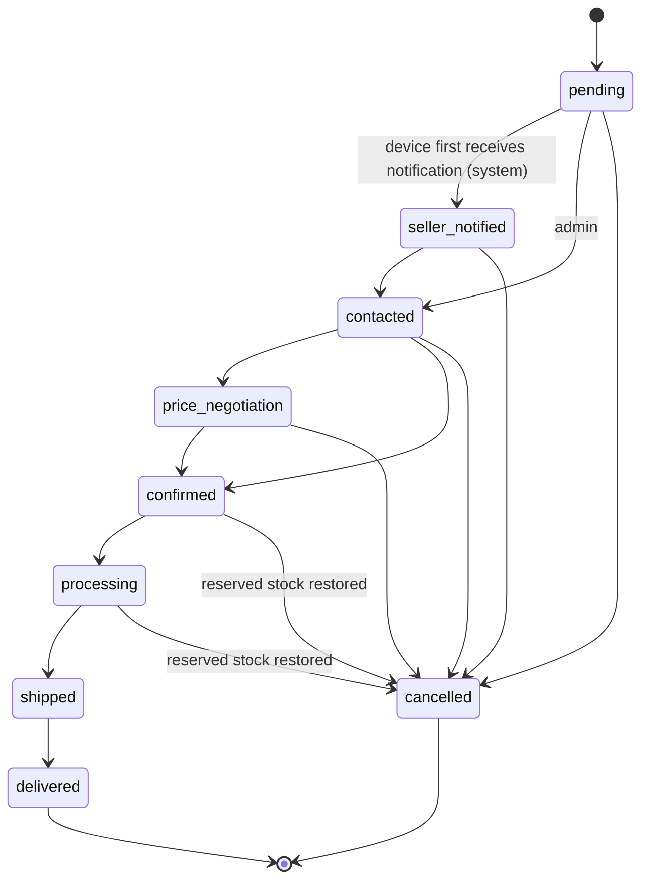

# API Design

Base URL: `https://<backend-host>/api` · JSON unless stated · Time = ISO-8601 UTC · Money = integer BDT.
See also: [SYSTEM_ARCHITECTURE](SYSTEM_ARCHITECTURE.md) · [DATABASE_DESIGN](DATABASE_DESIGN.md)

Endpoint paths required by the PDF (§9) are kept **verbatim**; additions needed to make the PDF's features work are marked ➕.

## 1. Conventions

* **Auth modes:** `public` · `user` (Firebase ID token: `Authorization: Bearer <token>`) · `admin` (user + role claim) · `device` (`X-Device-Id`, `X-Device-Secret`) · `order-access` (admin, or owner uid, or `X-Tracking-Token`).
* **Errors:** `{ "error": { "code": "VALIDATION_ERROR", "message": "…", "details": [...], "requestId": "…" } }`. No stack traces.
* **Common codes:** `400 BAD_REQUEST/VALIDATION_ERROR` · `401 UNAUTHORIZED` · `403 FORBIDDEN` · `404 NOT_FOUND` · `409 CONFLICT` (illegal state transition, duplicate) · `413 PAYLOAD_TOO_LARGE` · `415 UNSUPPORTED_MEDIA_TYPE` · `429 RATE_LIMITED` (+`Retry-After`) · `5xx` retryable.
* **Pagination:** cursor-based: `?limit=20&cursor=<opaque>` → `{ items:[…], nextCursor: "…"|null }`. No offset.
* **Idempotency:** `Idempotency-Key` header (orders), `X-Capture-Id` (device uploads).
* **Validation:** zod schema per route; unknown fields rejected on writes.
* **Every response** carries `X-Request-Id`.

### Middleware order
`requestId/log → helmet → CORS → rate limit → body parser (json 100 KB | raw image/jpeg ≤1 MB on upload) → [authUser | authDevice] → requireRole → validate → controller → errorHandler`.

## 2. Health
| Method | Path | Auth | Notes |
|--------|------|------|-------|
| GET | `/health` (also `/api/health`) | public | liveness; later includes Firestore ping |

## 3. Device APIs (auth: `device`)

All device calls include `X-Firmware-Version`. The server **ignores** any `potterId`/`deviceId` in bodies; identity comes from credentials. Rate limit keyed by authenticated `deviceId`; daily upload cap per device.

### `POST /api/device/upload`
* Headers: `Content-Type: image/jpeg`, `X-Capture-Id: <8–64 chars [A-Za-z0-9_-]>`
* Body: raw JPEG (≤ 1 MB; magic bytes `FF D8 FF` + decodable).
* `202 { "productId": "…", "status": "received" }`
* Duplicate `X-Capture-Id` → `200` with the same `productId` (no new product, no second AI job).
* Errors: `401` bad creds · `403` device not active / potter inactive · `413` · `415` · `429`.
* **Processing order (reliability):** (1) authenticate; (2) quota check; (3) validate size, JPEG start (`FF D8 FF`) **and end (`FF D9`, detects truncated uploads)** and decodability; (4) fast-path: if `uploads/{deviceId}_{captureId}` exists → return it; (5) pre-generate `productId`; (6) **write the original to Storage first**; (7) transaction: create `uploads` doc + draft product. A crash between 6 and 7 only leaves an orphan blob (swept by a cleanup job) — never a product without an image — and the device's retry simply repeats the sequence. The capture is therefore only acknowledged (`202/200`) once both the image and the record exist.

### `GET /api/device/notifications`
* Returns unacknowledged, unexpired notifications for **this device** (oldest first, ≤5).
```json
{
  "serverTime": "2026-11-19T10:00:00Z",
  "pollIntervalSec": 300,
  "notifications": [{
    "id": "ORD-7K3QWXZ2AB_NEW_ORDER",
    "type": "NEW_ORDER",
    "orderId": "ORD-7K3QWXZ2AB",
    "product": "Handmade Clay Vase",
    "thumbnailUrl": "https://…/thumb.jpg",
    "buyerName": "Rahim Ahmed",
    "buyerPhone": "01XXXXXXXXX",
    "address": "Dhaka, Bangladesh",
    "quantity": 1
  }]
}
```
* Side effects: `lastSeen`; `pending→delivered`, `deliveryCount++`; order `pending→seller_notified` (first delivery only, **only if the order is still `pending`** so a later admin status is never regressed; writes an `order_history` row with `updatedBy {type:'device'}`). Re-served until acknowledged (this is the retry mechanism). Notifications whose order is `cancelled` are not served. The device should add ±10 % random jitter to `pollIntervalSec` to avoid synchronised polling spikes.
* `type` is `NEW_ORDER` or `ORDER_CANCELLED` (the latter payload carries only `orderId`, product and a "cancelled" flag — no buyer data).

### `POST /api/device/acknowledge`
* Body: `{ "notificationId": "ORD-…_NEW_ORDER" }` → `200 { "status": "acknowledged" }`. Idempotent. Foreign/unknown notification → `404`.
* Acknowledged means **seen**, not accepted.

### `POST /api/device/heartbeat`
* Body: `{ "firmwareVersion": "1.0.0", "batteryPct": 80, "signalCsq": 18, "queuedUploads": 0, "droppedUploads": 0 }` (all optional, bounded)
* `200 { "serverTime": "…", "pollIntervalSec": 300 }`. Sent only when nothing else was sent recently (saves data).

### Device authentication details
* Order of checks: load device by `X-Device-Id` → **always** compute the hash and `timingSafeEqual` (against a dummy hash if the device doesn't exist, so unknown-ID and wrong-secret are indistinguishable by response *and* timing) → only after the secret is valid check `status`/potter status → `403` (a stranger can therefore never learn that a device ID exists).
* Failed-auth limiter (per IP): carrier-grade NAT shares IPs, so it must not lock out legitimate devices. It only throttles requests that **fail** verification; requests with a valid secret are never blocked by it.

### Device error handling contract
* `401` / `403` → **keep the image queued**, retry at a long interval (e.g. hourly) and show an error code — an admin may fix or re-enable the device.
* `408` / `429` / `5xx` / network errors → exponential backoff + jitter, keep queued.
* `400` / `413` / `415` → the image itself is rejected; discard it and flag it in the next heartbeat.
* Local queue cap (firmware, Phase 8): when storage is full drop the **oldest** capture and report `queuedUploads`.

## 4. Public / customer APIs

| Method | Path | Auth | Description |
|--------|------|------|-------------|
| GET | `/api/products` | public | Approved products. Query: `q, category, minPrice, maxPrice, sort (newest\|price_asc\|price_desc), potterId?, limit, cursor` |
| GET | `/api/products/:id` | public | Approved product only (else `404`) |
| ➕ GET | `/api/categories` | public | Fixed category list (+ counts optional) |
| ➕ GET | `/api/potters/featured` | public | Public-safe potter cards `{id,name,village,district,bio}` |
| POST | `/api/orders` | public (guest) or user | Create order request |
| GET | `/api/orders/:id` | order-access | Customer-safe order view |
| ➕ GET | `/api/me/orders` | user | *(implemented as `GET /api/customers/me/orders`, see §13)* |
| ➕ GET / PATCH | `/api/customers/me` | user | *(implemented in Phase 5, see §13; replaces the earlier draft `/api/me`)* Read / create-or-update own customer profile |

**Public product payload** (allow-list; no `potterId`, `deviceId`, AI internals, original path):
```json
{ "id":"…","name":"…","description":"…","category":"Home Decoration","material":"Terracotta clay",
  "tags":["handmade"],"price":450,"imageUrl":"…","thumbUrl":"…","stock":1,"available":true,
  "seller":{"name":"…","village":"…","district":"…"},"createdAt":"…" }
```

### `POST /api/orders`
* Headers: `Idempotency-Key: <uuid>` (required); optional `Authorization` (if present it must be a **valid** token → otherwise `401`; it is never silently ignored).
* Body: `{ "productId":"…","quantity":1,"buyerName":"…","buyerPhone":"01XXXXXXXXX","deliveryAddress":"…" }`
* Validation: phone regex, address 10–300 chars, quantity 1–50, product `approved` with potter `active`, requested quantity ≤ stock (soft check), phone not in `blocked_phones` (`403`).
* `201 { "orderId":"ORD-…","trackingToken":"…","status":"pending" }`.
* **Idempotent replay** (same `Idempotency-Key` + same phone) → `200` with the existing order and a **freshly issued** `trackingToken` (the previous token is invalidated). This is deliberate: a replay almost always means the first response was lost, and the buyer must still be able to track. Same open order for the same phone + product within 10 minutes under a *different* key → `409 DUPLICATE_ORDER`. Rate-limited per IP and per phone.
* Server (one transaction): create `idempotency_keys` doc (fails if it exists ⇒ race-free), copy `potterId` from the product, snapshot buyer/product/price, create the `orders` doc and the creation `order_history` row (`previousStatus: null`), create `notifications/{orderId}_NEW_ORDER` for the potter's most recently seen active device. Flags `needsAdminAttention` immediately with `attentionReason` = `no_active_device` (and no notification) or `device_offline` (target device's `lastSeen` older than `2×pollIntervalSec + grace`). A background escalation sweep later flags still-unacknowledged notifications (`unacknowledged`, after `NOTIFICATION_ESCALATION_MINUTES`, default 120).
* Tracking link in the confirmation page: `/track/:orderId#<token>` — the **URL fragment** is never sent to servers or logged; the SPA moves it into the `X-Tracking-Token` header.

### `GET /api/orders/:id`
* Access: admin, **or** owner (`customerId == uid`), **or** header `X-Tracking-Token` matching `trackingTokenHash`. Otherwise `404` (not `403`, no enumeration).
* Customer-safe response: `{ id, status, productName, quantity, listedPrice, negotiatedPrice, courierName, trackingNumber, timeline:[{status,timestamp}], createdAt }` — never potter phone/address, never internal notes.

## 5. Admin APIs (auth: `admin`)

| Method | Path | Description |
|--------|------|-------------|
| ➕ GET | `/api/admin/dashboard` | Counts: potters, devices (total/online/offline), products, pending approvals, orders, pending orders, unacknowledged notifications |
| POST | `/api/admin/potters` | Register potter → generated `POT-####` |
| GET | `/api/admin/potters` | List/search/filter (`status, district, q`), paginated |
| ➕ GET | `/api/admin/potters/:id` | Profile + device list + product/order counts |
| ➕ PATCH | `/api/admin/potters/:id` | Edit name/phone/village/district/address (strict; status is not editable here) |
| ➕ PATCH | `/api/admin/potters/:id/status` | `{status:'active'\|'inactive'}` — activate/deactivate (products and devices follow, see §11.1) |
| POST | `/api/admin/devices` | Register device → `DEV-###` + **secret (shown once)** |
| GET | `/api/admin/devices` | List with derived `connectivity`/`displayStatus`, filters (`status`, `q`) |
| POST | `/api/admin/devices/assign` | `{deviceId, potterId}` assign/reassign (transaction + audit) |
| ➕ PATCH | `/api/admin/devices/:id/status` | `active\|disabled\|lost` (+ optional `reason`); `lost` also revokes credentials |
| ➕ POST | `/api/admin/devices/:id/revoke` | Revoke credentials immediately (hash deleted; active device becomes `disabled`) |
| ➕ POST | `/api/admin/devices/:id/credentials` | Issue a new secret (shown once); old one invalid immediately (replaces the earlier draft name `rotate-secret`) |
| ➕ GET | `/api/admin/products` | List all; filters `status, potterId, aiStatus, q` |
| ➕ GET | `/api/admin/products/:id` | Full record incl. AI fields and private image URL (signed, short-lived) |
| ➕ PATCH | `/api/admin/products/:id` | Edit name/description/category/material/tags/price/stock/featured |
| PATCH | `/api/admin/products/:id/approve` | Preconditions (any AI outcome): `status ∈ {pending_review}`, non-empty `name`, `description`, `category`, `price ≥ 1`, `stock ≥ 1`; else `400`/`409`. Publishes web/thumb variants |
| ➕ PATCH | `/api/admin/products/:id/reject` | `{reason}` |
| ➕ DELETE | `/api/admin/products/:id` | Soft remove (`status:'removed'`) |
| GET | `/api/admin/orders` | List; filters `status, potterId, needsAttention, from, to`, paginated |
| ➕ GET | `/api/admin/notifications` | Follow-up queue: filters `status (pending\|delivered\|acknowledged), olderThanMinutes, deviceId, potterId` — for inspection; flagging is **automatic** (escalation sweep sets `needsAdminAttention`), so nothing depends on an admin remembering to look |
| ➕ GET / POST / DELETE | `/api/admin/blocked-phones` | Manage the anti-abuse block-list (covers guests) |
| ➕ GET | `/api/admin/audit-logs` | Paginated audit trail (filters: action, target, actor, date) |
| ➕ GET | `/api/admin/reports/{products,potters,orders,devices}` | Aggregates (counts by status/category/potter/district/period; device uptime buckets) |
| ➕ POST | `/api/admin/admins` (superadmin) | Grant admin role (claim + `admins` doc) |

### Device registration response (the only time the secret is visible)
```json
{ "device": { "id":"DEV-004", "status":"unassigned", "hasCredential":true, "credentialFingerprint":"2cf078a0", "credentialVersion":1, "...": "..." },
  "provisioning": { "deviceId":"DEV-004", "secret":"<43-char base64url>", "credentialVersion":1, "shownOnce":true } }
```
`201`, `Cache-Control: no-store`. The same `provisioning` shape is returned by `POST /api/admin/devices/:id/credentials`. The secret appears in no other response, log line or audit entry.

## 6. Order APIs (auth: `admin`)

| Method | Path | Body | Notes |
|--------|------|------|-------|
| PATCH | `/api/orders/:id/status` | `{ "status":"contacted", "note":"…", "courierName?", "trackingNumber?" }` | Validated by the state machine → `409` if illegal; writes `order_history`; **`cancelled` returns the reserved stock** (stock is reserved when the order is placed, see §13; `confirmed` no longer touches it) |
| PATCH | `/api/orders/:id/price` | `{ "negotiatedPrice": 420, "note?": "…" }` | Allowed in `contacted`/`price_negotiation`/`confirmed`; unit price; history row records previous/new |
| GET | `/api/orders/:id/history` | — | Full history incl. `updatedBy` (admin only) |

## 7. Order state machine


* Terminal: `delivered`, `cancelled`. Anything not drawn is `409 CONFLICT`.
* `pending → seller_notified` is the only **system/device-driven** transition and applies **only while the order is still `pending`**; if an admin already moved it to `contacted` or later, delivery never regresses it.
* `seller_notified` = notification **delivered** to the device. Acknowledged is tracked on the notification, not as an order status. Neither implies acceptance — acceptance is only ever the admin-recorded `contacted → price_negotiation → confirmed` path.
* Customers cannot cancel via the API in v1 (they phone/ask support; an admin sets `cancelled`). A self-service cancel is a possible later addition.
* Each transition → one transaction: order update + `order_history` (+ restoring reserved stock when cancelling). *(Phase 5 design change: stock is reserved at order creation, not at confirmation, so two buyers can never be promised the same last piece. `OrdersRepository.cancel` already implements the restore; the admin status endpoint arrives in Phase 7.)*

## 8. Security matrix

| Endpoint group | Public | Customer | Admin | Superadmin | Device |
|----------------|:--:|:--:|:--:|:--:|:--:|
| Products / categories / featured potters | ✔ | ✔ | ✔ | ✔ | – |
| Create order | ✔ | ✔ | ✔ | ✔ | – |
| Read own order | token | uid | ✔ | ✔ | – |
| `/api/me`, `/api/me/orders` | – | ✔ | – | – | – |
| Admin APIs, order status/price/history | – | – | ✔ | ✔ | – |
| Create admins, rotate device secrets, DELETE data | – | – | – | ✔ | – |
| Device APIs | – | – | – | – | ✔ (own data only) |

Authentication notes: tokens travel in the `Authorization` header (not cookies), so classic CSRF does not apply; CORS allow-list still limits browser origins. **All `/api/admin/*` and order-management routes verify the ID token with `checkRevoked: true`** and require the role claim; deactivating an admin calls `revokeRefreshTokens(uid)` so access ends immediately. Customers have no role claim; Firebase email/password sign-up being open to the public is harmless because only the backend can set `role`.

## 9. Rate limits (initial)

| Scope | Limit |
|-------|-------|
| Public per IP | 300 req/min (current), tighter on `POST /api/orders` (e.g. 5/10 min per IP and per phone) |
| Failed device/user auth per IP | 20 / 10 min |
| Device per `deviceId` | 30 req/min; uploads ≤ N/day (default 50) |
| Admin per user | 600 req/min |

## 10. Logging and audit
Structured JSON logs with request ID; redact `Authorization`, `X-Device-Secret`, `X-Tracking-Token`, and buyer phone/address; log auth failures, rate-limit hits, AI job outcomes; `audit_logs` for sensitive admin actions.

## 11. Implemented in Phase 3 (admin API contract)

All routes below require `Authorization: Bearer <Firebase ID token>` with an `admin` or `superadmin` role claim (verified with `checkRevoked`). Order of enforcement: failed-auth limiter → token verification → role → per-admin limiter → input validation → handler. Query schemas are **strict** (unknown parameters → `400`); parsed values are the only input handlers use. Extra error code: `503 AUTH_UNAVAILABLE`.

| Method | Path | Role | Response |
|--------|------|------|----------|
| GET | `/api/admin/me` | admin | `{ uid, email, role, name, active }` — identity as verified by the server |
| GET | `/api/admin/dashboard` | admin | see below (cached ≈15 s) |
| GET | `/api/admin/activity?limit=1..50` (default 10) | admin | `{ items:[{ id, timestamp, action, actor:{type,id,name}, target:{collection,id,label} }] }`, newest first; change snapshots (`before/after`) are never exposed |
| GET | `/api/admin/orders?limit&cursor&status&potterId&needsAttention` | admin | `{ items, nextCursor }`; `trackingTokenHash` and `idempotencyKey` removed. Filter combinations limited to declared query shapes (e.g. `status`+`needsAttention` → 400) |
| GET | `/api/admin/products?limit&cursor&status&potterId` | admin | `{ items, nextCursor }` newest first |
| GET | `/api/admin/search?q=` | admin | exact-ID lookup `{ results:[{type,id,title,subtitle,status,path}], hint }` for `POT-…`, `DEV-…`, `ORD-…`; never returns credential hashes or buyer phones |
| GET | `/api/admin/admins?limit&cursor` | **superadmin** | admin directory `{ items:[{ id,name,email,role,active,createdAt }] }` |

`GET /api/admin/dashboard`:
```json
{ "generatedAt": "ISO",
  "counts": {
    "potters":  { "total": 0, "active": 0, "inactive": 0 },
    "devices":  { "total": 0, "online": 0, "offline": 0, "unassigned": 0, "disabled": 0, "lost": 0, "onlineWindowSec": 900 },
    "products": { "total": 0, "pendingApproval": 0, "byStatus": { "draft": 0, "pending_review": 0, "approved": 0, "rejected": 0, "removed": 0, "suspended": 0 } },
    "orders":   { "total": 0, "pending": 0, "needsAttention": 0, "byStatus": { "pending": 0, "...": 0 } } },
  "ordersByDay": [ { "date": "2026-11-19", "count": 0 } ] }
```
Definitions: `online` = `active` devices seen within `DEVICE_ONLINE_WINDOW_SEC` (default 900 s); `offline` = `active` devices not seen in that window (including never seen); `products.total` excludes `removed`; `ordersByDay` = last 14 **Bangladesh** (UTC+6) calendar days, oldest first. Every number is a Firestore `count()` aggregation; nothing is estimated.

Not yet implemented (later phases): write endpoints for products and orders, `/api/admin/reports/*`, `/api/admin/notifications`, `blocked-phones`, `audit-logs`.

### 11.1 Phase 4: potters and devices

Same stack, validation and error format as above. All bodies are **strict** (unknown keys such as `status`, `id`, `createdBy`, `potterId` on a potter body → `400`). The acting admin is always taken from the verified token. Error codes added: `DUPLICATE_PHONE` (409), `ID_COLLISION` (409), `NO_CREDENTIAL` (409), `NO_OWNER` (409), `POTTER_INACTIVE` (409), `DEVICE_NOT_ASSIGNABLE` (409), `DEVICE_LOST` (409), `RATE_LIMITED` (429, with `Retry-After`, device API).

| Method | Path | Body / query | Response |
|--------|------|--------------|----------|
| GET | `/api/admin/meta` | — | `{ districts:[64 names], deviceStatuses, onlineWindowSec }` |
| POST | `/api/admin/potters` | `{ name, phone, village, district, address, bio?, featured? }` | `201 { potter }` — `POT-####` generated in a transaction; phone normalised (`+8801712345678` → `01712345678`); district canonicalised; duplicate phone → `409 DUPLICATE_PHONE` |
| GET | `/api/admin/potters` | `limit, cursor, status, district, q` | `{ items, nextCursor, truncated }`. `q` = name/village words, phone (full or prefix) or `POT-…` prefix; search results are capped (`truncated:true` ⇒ refine) and not cursor-paged; status/district apply to results |
| GET | `/api/admin/potters/:id` | — | `{ potter, devices:[…with connectivity], counts:{ devices, products, orders, openOrders } }`; products/orders use `GET /api/admin/products?potterId=` and `GET /api/admin/orders?potterId=` |
| PATCH | `/api/admin/potters/:id` | any of `name, phone, village, district, address, bio, featured` (≥1) | `{ potter }`; a phone change moves the reservation atomically; changed field names are audited |
| PATCH | `/api/admin/potters/:id/status` | `{ status:'active'\|'inactive' }` | `{ potter }`; inactive ⇒ approved products suspended, the potter's devices refused (`403`) until reactivation |
| POST | `/api/admin/devices` | `{ model?, pollIntervalSec? (30–3600) }` | `201 { device, provisioning }` (see §5, secret shown once). Device starts `unassigned` |
| GET | `/api/admin/devices` | `limit, cursor, status (unassigned\|active\|offline\|disabled\|lost), q` | `{ items, nextCursor }`; each item has `connectivity`, `displayStatus`, `potter:{id,name,village,district,status}\|null`. `active` = stored-active **and** online; `offline` = stored-active but silent/never seen; `q` = Device-ID prefix (case-insensitive, `001` ≡ `DEV-001`) |
| GET | `/api/admin/devices/:id` | — | `{ device }` with `connectivity`, `displayStatus`, `potter`, `hasCredential`, `credentialFingerprint`, `credentialVersion`, `credentialRevokedAt`, telemetry |
| GET | `/api/admin/devices/:id/events` | `limit, cursor` | communication history `{ items:[{ id, type:'heartbeat'\|'rejected', at, … }], nextCursor }`, newest first, 30-day retention |
| GET | `/api/admin/devices/:id/audit` | `limit, cursor` | administrative history `{ items:[{ id, timestamp, action, actor:{type,id,name}, before, after }] }` |
| POST | `/api/admin/devices/assign` | `{ deviceId, potterId }` | `{ device }`. `404` unknown device/potter; `409` inactive potter, `disabled`/`lost` device or device without credential; re-assigning to the current owner is idempotent; reassignment re-targets pending notifications |
| PATCH | `/api/admin/devices/:id/status` | `{ status:'active'\|'disabled'\|'lost', reason? (3–200) }` | `{ device }`. `active` needs an owner, an active owner and a credential; `lost` revokes credentials in the same transaction |
| POST | `/api/admin/devices/:id/revoke` | `{ reason? }` | `{ device }`; idempotent; deletes the stored hash, bumps `credentialVersion`, disables an active device |
| POST | `/api/admin/devices/:id/credentials` | `{}` | `201 { device, provisioning }`; refused with `409 DEVICE_LOST` while lost; status unchanged (a revoked/disabled device must still be enabled explicitly) |

**Device endpoint (Phase 4): `POST /api/device/heartbeat`** — headers `X-Device-Id`, `X-Device-Secret`. Body: telemetry only (`firmwareVersion, batteryPct, signalCsq, queuedUploads, droppedUploads`, all optional); anything else, including `potterId`, is `400`. `200 { serverTime, pollIntervalSec }`. Failure modes: `401` for every credential failure with one generic message (unknown ID, wrong/revoked secret, malformed headers); `403` when the secret is valid but the device is `disabled`/`unassigned` or its potter is inactive (recorded in `device_events`); `429` only after repeated *failed* attempts (per IP and per Device ID) — a device presenting a valid secret is never throttled by others' failures; per-device limit 60/min. The device router is mounted before the per-IP limiter because cellular devices share NAT addresses. A lost device always gets `401` because its hash was deleted.

## 13. Implemented in Phase 5 (storefront contract)

Mounted in `routes/marketplace.routes.js`. Errors use the common format. Query and body schemas are **strict** (unknown keys → `400`).

### 13.1 Public catalogue (no authentication, read-only)

| Method | Path | Notes |
|--------|------|-------|
| GET | `/api/products` | Query: `q` (1–60), `category`, `minPrice`, `maxPrice`, `sort` (`newest`\|`price_asc`\|`price_desc`), `potterId`, `featured=true`, `limit` (1–48, default 12), `cursor`. Response `{ items, nextCursor }` |
| GET | `/api/products/:id` | Approved products only (else `404`). A sold-out product is returned with `available:false` so existing links and order pages keep working |
| GET | `/api/categories` | `{ items:[{ name, count }] }`, approved products per category, most popular first (cached 60 s) |
| GET | `/api/potters/featured` | Active, featured potters that have ≥1 approved product: `{ id, name, village, district, bio, productCount }` |
| GET | `/api/districts` | The 64 districts used by checkout and address forms |

Only `approved` products are ever read. Listings omit products with `stock = 0` ("available for sale"); the list refills pages so a page is not short because of hidden items. **Public product payload** (allow-list, verified by test): `id, name, description, category, material (null when unknown), tags, price, imageUrl, thumbUrl, stock, available, featured, seller{name,village,district}, createdAt`. Never `potterId`, `deviceId`, AI fields, search tokens or private image paths; image URLs are built only for `public/products/**`.

Query strategy: the default, category, price-sort and `featured` queries use declared, indexed shapes (`status [+category] × createdAt|price`). **Search (`q`), seller filter (`potterId`) and "newest within a price range"** cannot be ordered by Firestore, so the newest 300 approved products matching the indexed part are fetched and filtered/sorted in memory with offset cursors. This is exact for catalogues up to 300 active listings; beyond that an external search index is the upgrade path (audit P5-1). Combinations that match no declared shape are a `400`, never an un-indexed query.

### 13.2 Signed-in customer (`Authorization: Bearer <Firebase ID token>`, verified with `checkRevoked`)

| Method | Path | Body | Response |
|--------|------|------|----------|
| GET | `/api/customers/me` | — | `{ uid, email, customer }` (`customer` is `null` until the profile exists) |
| PATCH | `/api/customers/me` | `{ name?, phone? }` | `{ customer }`. The first call creates the profile and needs both; `email` is taken from the verified token, never from the body |
| GET | `/api/customers/me/orders` | `?limit&cursor` | `{ items, nextCursor }`, customer-safe order views, newest first |
| POST | `/api/customers/me/addresses` | `{ label, recipientName, phone, line, district, isDefault? }` | `201 { addresses }` (max 5; the first is the default; exactly one default always exists) |
| PATCH | `/api/customers/me/addresses/:addressId` | any of the fields | `{ addresses }` |
| DELETE | `/api/customers/me/addresses/:addressId` | — | `{ addresses }` |

Every method uses the uid from the verified token, so a customer can only ever read or change their own document (an address id belonging to someone else is `404`). Customers carry no role claim: all `/api/admin/*` routes answer `403`. Extra error codes: `PROFILE_REQUIRED` (409), `ADDRESS_LIMIT` (409).

### 13.3 Orders

| Method | Path | Notes |
|--------|------|-------|
| POST | `/api/orders` | Guest or signed-in. Headers: `Idempotency-Key` (8–128, **required**), optional `Authorization` (if present it must be valid, else `401`; never silently treated as a guest). Body: `{ productId, quantity (1–50), buyerName, buyerPhone, deliveryAddress (10–300), deliveryDistrict }`. `201 { orderId, trackingToken, status:'pending', replayed:false }`, `Cache-Control: no-store` |
| GET | `/api/orders/:id` | Owner (verified uid), **or** header `X-Tracking-Token`, **or** admin. Anyone else: `404`. Response `{ order }` with `timeline` |

Order creation (one transaction, `OrdersRepository.place`):
1. **Idempotency**: `idempotency_keys/{sha256(phone:key)}` → order. A replay returns `200` with the same order (`replayed:true`) and a **fresh** tracking token (the old one stops working). Same key with a different product/quantity → `409 IDEMPOTENCY_MISMATCH`. Concurrent identical requests produce exactly one order.
2. **Duplicate guard**: same phone + same product within 10 minutes under a different key while the earlier order is open → `409 DUPLICATE_ORDER` (`dup_…` lock document).
3. **Potter, price, name and image come from the stored product**: the body cannot carry them (`400`). Product must be `approved`, potter `active`.
4. **Stock is reserved**: `stock -= quantity`; `409 INSUFFICIENT_STOCK` ("Only N left" / "sold out"). Verified with 8 concurrent buyers for 3 units (exactly 3 succeed). `OrdersRepository.cancel` returns the units.
5. Order document (`status:'pending'`, snapshot of buyer and product, `deliveryDistrict`) and its first `order_history` row are created together. A signed-in order stores `customerId` from the token; a user without a profile gets `409 PROFILE_REQUIRED`.
6. **Notifications are not created yet**: the order is stored ready for Phase 9 (potter, buyer snapshot, `pending`). Until then pending orders are visible to admins only.

Rate limits: per IP 15 / 10 min and per buyer phone 10 / 10 min on order creation; per signed-in user 300 req/min; 4xx answers on customer/order-read routes count toward the failed-request limiter (30 / 10 min per IP).

**Customer-safe order view**: `id, status, productId, productName, productImageUrl, quantity, listedPrice, negotiatedPrice, courierName, trackingNumber, delivery{name, phone, address, district}, createdAt, updatedAt` (+ `timeline:[{status,timestamp}]` on the detail view). A token holder gets the phone masked (`01*******78`). Never: potter identity/contact, `potterId`, internal notes, `updatedBy`, `needsAdminAttention`, token hashes, idempotency keys.

## 12. Testing the API (per phase)
Phase 3 coverage: see [ADMIN_AUTH.md §4](ADMIN_AUTH.md#4-what-is-tested).
Unit tests for services (state machine, idempotency, credential hashing); integration tests against Firebase emulators for isolation (device A cannot read/ack/upload as B; customer A cannot read B's order; non-admin gets 403; disabled device gets 403; illegal transitions → 409; duplicate upload/order → single record).
