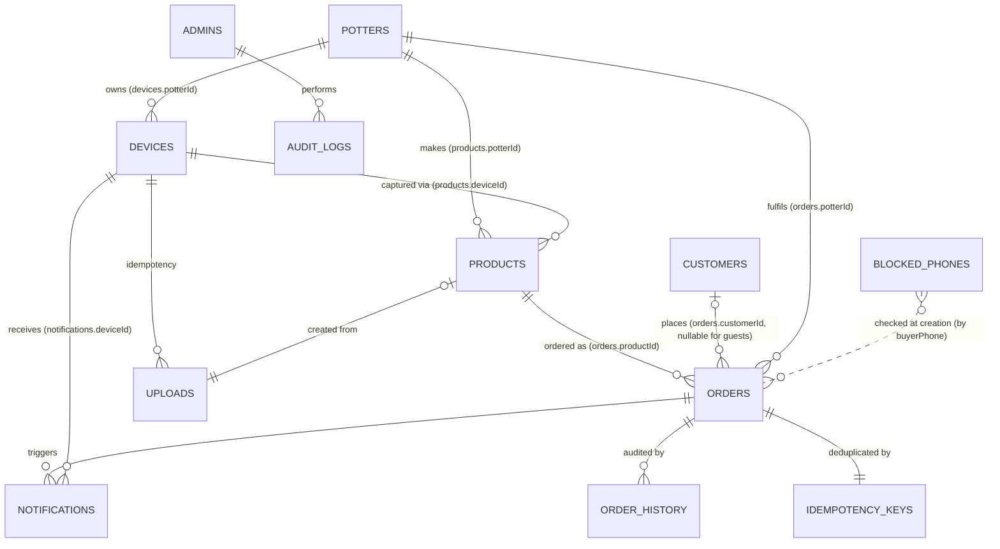

# Database Design (Cloud Firestore)

See also: [SYSTEM_ARCHITECTURE](SYSTEM_ARCHITECTURE.md) · [API_DESIGN](API_DESIGN.md)

Location: **asia-south1 (Mumbai)**. Prices are **integers in BDT** (taka). All timestamps are Firestore `Timestamp`s written with server time. All client access is denied by rules; every read/write goes through the backend (Admin SDK).

## 1. Entity relationships



Collections: the 8 required (`potters, devices, products, customers, orders, notifications, order_history, admins`) plus 5 supporting ones (`counters, uploads, idempotency_keys, blocked_phones, audit_logs`). A `stats` collection (pre-aggregated report counters) is **deferred to Phase 10** (see §8).

## 2. Document ID strategy (summary)

| Collection | Document ID | Why |
|-----------|-------------|-----|
| potters | `POT-1001` (counter-generated) | Staff quote it by phone; matches PDF |
| devices | `DEV-001` (counter-generated) | Printed on the device; matches PDF |
| products | Firestore auto-ID | No meaning needed, no hotspot |
| customers | Firebase Auth `uid` | 1:1 with the auth account; ownership checks are trivial |
| orders | `ORD-` + 10 chars base32 random | Unguessable (privacy) but human-readable |
| notifications | `{orderId}_{type}` (e.g. `ORD-7K3…_NEW_ORDER`) | Deterministic ⇒ idempotent creation |
| order_history | Auto-ID | Append-only |
| admins | Firebase Auth `uid` | Mirrors the claim |
| counters | name (`potter`, `device`) | Transactional ID generation |
| uploads | `{deviceId}_{captureId}` | Deterministic ⇒ idempotent device retries |
| idempotency_keys | `sha256(buyerPhone + ':' + Idempotency-Key)` hex | Deterministic ⇒ race-free duplicate-order prevention (Firestore cannot enforce a unique field, only a unique document ID) |
| blocked_phones | normalised phone `01XXXXXXXXX` | Anti-abuse block-list that also covers guests |
| audit_logs | Auto-ID | Append-only |

Counters use a transaction (`value += 1`); the `1001`/`001` seed values are set by the seed script. At scale a counter doc is limited to ~1 write/s, which is far above the rate at which admins register potters/devices.

## 3. Collections

Type notation: `string`, `int`, `bool`, `ts` (Timestamp), `map`, `array<T>`, `ref` (document ID stored as string), `T?` = nullable/optional.

### 3.1 `potters`
Registered artisans (created by admin).

| Field | Type | Notes |
|-------|------|-------|
| name | string | required, 2–100 |
| phone | string | normalised `01XXXXXXXXX`; **private** (admin only) |
| village | string | public-safe |
| district | string | public-safe |
| address | string? | private |
| status | `'active'\|'inactive'` | inactive ⇒ products suspended, device uploads rejected, new orders blocked (see §4) |
| featured | bool | for "Featured potters" on the home page |
| bio | string? | optional public text |
| registrationDate | ts | |
| createdBy | ref (admin uid) | |
| updatedAt | ts | |

* **Relationships:** `devices.potterId`, `products.potterId`, `orders.potterId` point here.
* **PDF deviation:** the PDF lists `deviceIds`. We **do not store it**: `devices.potterId` is the single source of truth (avoids drift). "A potter's devices" = query `devices where potterId == X`.
* **Indexes:** single-field defaults; composite `(status, featured)` for the home page; `(status, district)` and `(district)` for the admin filters (all generated from query shapes).
* **Phase 4 additions:** derived search fields `nameLower` (lower-case name, prefix search) and `searchTokens` (name + village words); never returned by the API. **Phone uniqueness** is enforced by the reservation document `potter_phones/{phone}` (§3.9), written in the same transaction as the potter. `district` is validated against the 64 districts of Bangladesh and stored in canonical spelling (`comilla` → `Cumilla`).
* **Security:** phone/address never leave admin endpoints; public API returns `{id, name, village, district, bio}` only. Changing name/village/district triggers a denormalised refresh on that potter's products (batched job).

### 3.2 `devices`
IoT devices; ownership and credentials.

| Field | Type | Notes |
|-------|------|-------|
| potterId | ref? | null while `unassigned` |
| credentialHash | string? | `SHA-256(secret)` hex (lowercase); **never** the secret. The secret is a server-generated 32-byte random value (`crypto.randomBytes`), so brute-forcing a leaked hash is infeasible and no pepper is needed. Client-chosen secrets are never accepted. **`null` once revoked** (Phase 4): nothing can match a deleted hash |
| credentialVersion | int | incremented on every rotation **and** revocation (audit) |
| credentialRevokedAt | ts? | set when credentials are revoked (admin revoke or `lost`), cleared when new ones are issued |
| model | string? | hardware model, e.g. `ESP32-S3 + A7670E` |
| status | `'unassigned'\|'active'\|'disabled'\|'lost'` | only `active` may call device APIs. `assign` moves `unassigned→active`; assigning to an `inactive` potter is rejected (`409`); `disabled`/`lost` devices must be explicitly re-enabled. `offline` is **not stored** (see below). Enabling needs an owner, an active owner potter **and a valid credential**; `lost` revokes the credential in the same transaction; `lost` can only be left via `disabled` |
| pollIntervalSec | int | default 300; returned to device on poll |
| lastSeen | ts? | updated by poll/heartbeat/upload |
| firmwareVersion | string? | from header/heartbeat |
| batteryPct | int? | telemetry |
| signalCsq | int? | telemetry |
| queuedUploads | int? | telemetry (photos waiting on the device) |
| droppedUploads | int? | telemetry (photos the device had to discard — queue full or rejected); admin alert when > 0 |
| registeredAt | ts | |
| assignedAt | ts? | |
| updatedAt | ts | |

* **Online/offline is derived**, not stored (Phase 4 implementation): `connectivity = never_seen` if `lastSeen` is null, else `online` if `now − lastSeen ≤ DEVICE_ONLINE_WINDOW_SEC` (default 900 s), else `offline`. The API's `displayStatus` is `offline` for an `active` device that is not `online`, otherwise the stored status.
* **Relationships:** one device → at most one potter at a time; one potter → many devices. Reassignment = transaction updating `potterId`/`assignedAt` + `audit_logs`; pending notifications for the old potter are re-targeted or expired by the same transaction. A single `potterId` field makes simultaneous ownership by two potters structurally impossible.
* **Indexes:** `(potterId)`; `(status, lastSeen)` ascending and descending for the offline/online lists (generated from query shapes); count aggregations for dashboard.
* **Security:** `credentialHash` is never returned by any API: admin views get `hasCredential`, `credentialFingerprint` (first 8 hex characters of the digest, enough to tell generations apart, useless to an attacker) and `credentialVersion`. Heartbeat writes are limited to the telemetry fields above.

### 3.3 `products`
One draft product per accepted device capture (v1); published after admin approval.

| Field | Type | Notes |
|-------|------|-------|
| potterId | ref | **copied from `req.device` server-side** |
| deviceId | ref | capturing device |
| name | string | AI → editable |
| description | string | AI → editable (sanitised plain text) |
| category | string | from a fixed enum (`Home Decoration`, `Kitchenware`, `Garden`, `Tableware`, `Storage`, `Other`) |
| material | string | `'unknown'` allowed |
| tags | array<string> | ≤10, normalised lowercase |
| price | int? | **null until admin sets**; required to approve |
| suggestedPrice | map? | `{minimum:int, maximum:int, currency:'BDT'}` from AI (field names match the PDF's AI response) |
| images | array<map> | `{path:string, kind:'original'\|'web'\|'thumb', w:int, h:int}` |
| imageUrl | string? | public URL of the web variant (set on approval) |
| stock | int | default 1; admin-editable. **Units available for sale**: an order request *reserves* its quantity immediately (`stock -= quantity` in the order transaction); cancelling returns it (Phase 5 change; previously decremented at Confirmed) |
| status | `'draft'\|'pending_review'\|'approved'\|'rejected'\|'removed'\|'suspended'` | only `approved` is public. `draft` = AI not finished; `pending_review` = ready for admin (also used when AI **failed**, flagged `ai_failed`, so the admin can fill it in manually); `suspended` = hidden because the potter was deactivated (`statusBeforeSuspend` stores the prior value, restored on reactivation) |
| statusBeforeSuspend | string? | |
| aiStatus | `'queued'\|'processing'\|'done'\|'failed'` | |
| aiAttempts | int | |
| aiLeaseUntil | ts? | worker lease for crash recovery |
| aiNextAttemptAt | ts? | retry backoff schedule |
| aiError | string? | last error (no secrets) |
| aiConfidence | string? | `'low'\|'medium'\|'high'` |
| aiFlags | array<string> | e.g. `not_pottery`, `low_quality` |
| rejectionReason | string? | |
| featured | bool | home page |
| potterName, potterVillage, potterDistrict | string | **denormalised** (see below) |
| searchTokens | array<string> | lowercase tokens from name/tags/category for `array-contains` search |
| createdAt, updatedAt | ts | |
| approvedBy, approvedAt | ref?, ts? | |

* **Denormalisation (documented):** `potterName/Village/District` are copied so list and detail pages need no extra potter read per item. Only public-safe fields are copied; refreshed when the potter's profile changes. `searchTokens` exist because Firestore has no text search.
* **Relationships:** `potterId → potters`, `deviceId → devices`; `orders.productId → products`.
* **Indexes (composite):**
  * `(status, createdAt desc)` — default shop listing
  * `(status, category, createdAt desc)` — category filter
  * `(status, price asc)` and `(status, price desc)` — price sort/filter
  * `(status, category, price)` — category + price
  * `(status, potterId, createdAt desc)` — potter page; admin by potter
  * `(status, featured, createdAt desc)` — home
  * `(status, searchTokens array-contains, createdAt desc)` — search
  * `(aiStatus, aiNextAttemptAt)` and `(aiStatus, aiLeaseUntil)` — worker claim queries (queued/ready-to-retry; expired leases)
* **Query limitation:** Firestore permits range/inequality filters on one field, so *price range + sort by newest* needs the price index and client-side secondary ordering; cursor pagination (`startAfter`) throughout.
* **Security:** public API filters `status == 'approved'` and a hard allow-list of returned fields (no `potterId`, `deviceId`, `ai*`, original image path). Originals live under a private path.

### 3.4 `customers`
Optional accounts (guest checkout creates **no** customer doc).

| Field | Type | Notes |
|-------|------|-------|
| name | string | |
| phone | string | normalised |
| email | string? | |
| address | string? | legacy single address (Phase 2); superseded by `addresses` |
| addresses | array<map> | Phase 5: up to 5 saved delivery addresses `{ id, label, recipientName, phone, line, district, isDefault }`; `id` is generated by the backend; exactly one `isDefault` while any exist. Embedded (not a subcollection) because the list is tiny, always read with the profile and updated in one transaction |
| blocked | bool | **removed** — blocking is by phone via `blocked_phones` so it also covers guests |
| createdAt, updatedAt | ts | |

* **ID** = auth uid. Created by the first `PATCH /api/customers/me` after the browser registers with Firebase Auth (`name` + `phone` required; `email` is copied from the verified token). **Indexes:** defaults. **Security:** the API only ever reads/writes the document whose ID equals the verified token's uid; the Firestore rules deny all client access. Addresses and phone are private and redacted from logs. Guests create no customer document.

### 3.5 `orders`

| Field | Type | Notes |
|-------|------|-------|
| productId | ref | |
| potterId | ref | **copied from the product server-side** |
| customerId | ref? | uid; null for guests |
| trackingTokenHash | string | SHA-256 of the 128-bit random token returned to the buyer. Replaced (old token invalidated) if the same idempotent request is replayed, so a buyer whose response was lost can still track |
| idempotencyKey | string | client-supplied; uniqueness is enforced by the deterministic `idempotency_keys/{sha256(phone:key)}` document created in the same transaction |
| buyerName | string | snapshot |
| buyerPhone | string | snapshot, normalised `01XXXXXXXXX` |
| deliveryAddress | string | snapshot |
| deliveryDistrict | string? | snapshot, canonical district name (Phase 5; `null` on orders created before) |
| productName, productImagePath | string | snapshot for notification/thumbnail |
| quantity | int | 1–50 |
| listedPrice | int | snapshot of `price` at request time (unit price) |
| negotiatedPrice | int? | set by admin; **per-unit** price (total = negotiatedPrice × quantity) |
| status | enum | `pending, seller_notified, contacted, price_negotiation, confirmed, processing, shipped, delivered, cancelled` |
| courierName, trackingNumber | string? | manual |
| needsAdminAttention | bool | true when the potter may not see the order in time. `attentionReason`: `no_active_device` \| `device_offline` (set at creation) \| `unacknowledged` (set by the escalation sweep) \| `manual` |
| attentionReason | string? | see above |
| createdAt, updatedAt | ts | |

* **Snapshots (documented denormalisation):** an order is a historical record; it must not change if the profile/product changes.
* **Indexes:** `(potterId, createdAt desc)`, `(status, createdAt desc)`, `(customerId, createdAt desc)`, `(potterId, status, createdAt desc)`, `(needsAdminAttention, createdAt desc)`, `(buyerPhone, productId, createdAt desc)` (recent-duplicate guard).
* **Duplicate-order prevention (two layers, both inside the creation transaction):** (1) `idempotency_keys` document → a retried request returns the existing order; (2) a deterministic lock document `idempotency_keys/dup_{sha256(phone:productId)}` → `{orderId, createdAt}`; an order for the same phone + product within 10 minutes while the previous order is still open → `409 DUPLICATE_ORDER` (catches double-clicks with a *new* key). *(Phase 5: implemented as a lock document instead of a query, so it is race-free without an extra index.)*
* **Security:** guest/customer access = token/uid check in the service; admin all; potters/devices never read orders directly (only the join in the notification payload).
* **State machine:** see [API_DESIGN §7](API_DESIGN.md#7-order-state-machine).

### 3.6 `notifications`

| Field | Type | Notes |
|-------|------|-------|
| deviceId | ref | target device |
| potterId | ref | |
| orderId | ref | |
| type | `'NEW_ORDER'\|'ORDER_CANCELLED'` | one document per (order,type) so IDs stay unique; `ORDER_CANCELLED` is only created if the `NEW_ORDER` was already delivered or acknowledged (otherwise the `NEW_ORDER` is simply expired) |
| status | `'pending'\|'delivered'\|'acknowledged'\|'expired'` | |
| deliveryCount | int | |
| firstDeliveredAt, lastDeliveredAt | ts? | |
| acknowledgedAt | ts? | |
| expiresAt | ts | e.g. +7 days; expired ones are not served |
| createdAt | ts | |

* **No buyer PII stored here.** The poll endpoint joins the order at read time, so PII lives in one place and cancelled/expired orders stop being served. (`message` from the PDF is generated at read time.)
* `delivered` = device downloaded it; `acknowledged` = potter pressed the button (**seen**, not accepted).
* **Indexes:** `(deviceId, status, createdAt asc)` (device poll); `(status, createdAt)` (escalation sweep and the admin "unacknowledged" queue).
* **Security:** every query constrained by the authenticated `deviceId`; acknowledging a foreign notification returns `404`.

### 3.7 `order_history`
Append-only; written in the **same transaction** as the order change.

| Field | Type |
|-------|------|
| orderId | ref |
| previousStatus, newStatus | string (`previousStatus` is `null` on the creation row; every system, device-triggered and admin transition writes a row, including `pending→seller_notified`) |
| previousPrice, negotiatedPrice | int? |
| note | string? |
| updatedBy | map `{type:'admin'\|'system'\|'device', id:string}` |
| timestamp | ts |

* **Index:** `(orderId, timestamp asc)`. **Security:** admins see everything; customers get a sanitised status timeline (no internal notes/actor IDs).

### 3.8 `admins`

| Field | Type |
|-------|------|
| name, email | string |
| role | `'admin'\|'superadmin'` |
| active | bool |
| createdAt | ts |

* ID = auth uid. The **custom claim is authoritative** at request time; this doc is for listing/auditing. Created only by `scripts/create-admin.js` or a superadmin endpoint.

### 3.9 Supporting collections

**`counters/{name}`** — `{ value:int }`.

**`potter_phones/{phone}`** (Phase 4) — `{ potterId, createdAt }`. One document per registered phone number (normalised `01XXXXXXXXX` as the ID). Firestore has no unique constraints, so uniqueness is a *document-creation* constraint: the potter is created with `tx.create(potter)` + `tx.create(potter_phones/{phone})` in one transaction, and a second registration with the same number finds the reservation and fails with `409 DUPLICATE_PHONE` even under concurrent requests. A phone change deletes the old reservation and creates the new one atomically. Pre-Phase-4 potters are migrated with `npm run backfill:potters`.

**`device_events/{autoId}`** (Phase 4) — communication history. `{ deviceId, potterId, type:'heartbeat'|'rejected', at:ts, expireAt:ts, firmwareVersion?, batteryPct?, signalCsq?, queuedUploads?, droppedUploads?, reason? }`. Written **only for requests that proved the device secret**: a `heartbeat` event in the same batch as the `lastSeen` update, or a `rejected` event (reason `device_disabled`, `device_unassigned`, `device_lost`, `potter_inactive`) when an authentic device is refused. `potterId` is copied from the authenticated device record. Unauthenticated attempts are deliberately **not** stored (an attacker must not be able to fill the database). Index `(deviceId, at desc)`. `expireAt` = `at + 30 days` for a Firestore TTL policy (console/CLI step, tracked with the other TTL policies).

**`uploads/{deviceId}_{captureId}`** — `{ deviceId, potterId, captureId, productId, sizeBytes:int, sha256:string, createdAt }`. Existence ⇒ duplicate upload; return the original result without a second product or Gemini call. Written in the same transaction as the draft product, **after** the image is safely in Storage (see API_DESIGN §3). TTL policy (e.g. 30 days) may be added.

**`idempotency_keys/{sha256(phone:key)}`** — `{ orderId, createdAt }`; created inside the order-creation transaction (a second create of the same ID fails the transaction ⇒ race-free). TTL 7 days.

**`blocked_phones/{phone}`** — `{ reason, blockedBy, createdAt }`; checked by `POST /api/orders`. Managed by admins.

**`audit_logs/{id}`** — `{ actor:{type,id}, action:string, target:{collection,id}, before:map?, after:map?, timestamp:ts }` for device assign/reassign/disable, secret rotation, approve/reject/remove, status/price changes, admin creation. No secrets in `before/after`. Phase 4 actions: `potter.create`, `potter.update` (changed **field names** only; no phone/address), `potter.activate|deactivate`, `device.register`, `device.assign|reassign|enable|disable|mark_lost`, `device.revoke_credential`, `device.rotate_secret`; optional admin-entered `reason` is stored in `after.reason`. Index `(target.collection, target.id, timestamp desc)` serves the per-device history.

## 4. Managing multiple potters and devices

1. **Identity chain:** `device credential → devices/{deviceId}.potterId → potter`. The backend sets `req.device = {deviceId, potterId}` from the database record.
2. **Data scoping:** every device-facing query includes `where potterId == req.device.potterId` (or `deviceId == req.device.deviceId`). There is no code path that reads a potter ID from a device-supplied field.
3. **Many devices per potter:** `devices.potterId` index. New-order notifications go to the potter's most recently seen `active` device (tie-break: earliest `assignedAt`); if none is active, `orders.needsAdminAttention = true` (`no_active_device`); if the chosen device's `lastSeen` is older than `2×pollIntervalSec + grace`, the notification is still created but the order is flagged immediately (`device_offline`). (Future option: notify all devices.)
4. **Assignment lifecycle:** `unassigned → active` (assign) → `disabled`/`lost` (revoke) → `active` (re-enable or reassign). Reassignment: single transaction, audit log, old potter loses access instantly. **Whenever a device stops being `active` or changes owner, its still-pending notifications are re-targeted in the same transaction** to another `active` device of the same potter; if none exists the order gets `needsAdminAttention = true`. Products already captured keep their original `potterId`. *(Phase 4)* Credential state is part of the lifecycle: **revoke** deletes the hash (and disables an active device), **lost** revokes automatically and can only be recovered through `disabled` → *issue new credentials* → `active`; assigning or enabling a device without a valid credential is refused (`409 NO_CREDENTIAL`).
5. **Potter deactivation** (`status:'inactive'`): the potter's `approved` products are batch-set to `suspended` (restored from `statusBeforeSuspend` on reactivation) so the public `status == 'approved'` query needs no join; device uploads are rejected with `403`; new orders are blocked; open orders remain visible to admins.
6. **Scale:** all lists use indexed queries + cursor pagination; dashboard figures use `count()` aggregation queries; `lastSeen` writes are one small write per poll (≈288 writes/device/day at 5 min — trivial at pilot scale; poll interval is server-tunable).

## 5. Security rules

### Firestore (`firestore.rules`)
```
rules_version = '2';
service cloud.firestore {
  match /databases/{database}/documents {
    match /{document=**} { allow read, write: if false; }
  }
}
```
Backend uses the Admin SDK (bypasses rules); rules are a safety net against accidental client SDK access. Emulator tests assert that anonymous, customer and admin client sessions are all denied on every collection.

### Storage (`storage.rules`)
```
rules_version = '2';
service firebase.storage {
  match /b/{bucket}/o {
    match /public/products/{productId}/{file} { allow read: if true; allow write: if false; }
    match /{allPaths=**} { allow read, write: if false; }
  }
}
```
Originals (`uploads/{potterId}/{productId}/original.jpg`) are private; public web/thumb variants are copied to `public/products/…` on approval and deleted on reject/remove.

## 6. Data validation (enforced in the API with zod; mirrored here)
* Phone: `^01[3-9]\d{8}$` after normalising `+880`/`880` prefixes.
* Text lengths capped; HTML stripped from AI/admin text; tags ≤10 × ≤30 chars.
* `price`, `negotiatedPrice` integers `1..10_000_000`; `quantity` `1..50`.
* Category/status values are enums; unknown values rejected.
* IDs matched with strict regexes (`^POT-\d{4,}$`, `^DEV-\d{3,}$`, `^ORD-[A-Z2-7]{10}$`).

## 7. Retention and backup
Scheduled Firestore export (daily) to a Cloud Storage bucket; `uploads` and `idempotency_keys` use Firestore TTL policies; `audit_logs` kept long-term; order data retained per business/legal need **[decide]**.

## 8. Reporting at scale
`count()` aggregation queries are cheap for enumerable dimensions (status, category, device status). Per-potter / per-district / per-period reports across thousands of potters would need one query per group. Plan: Phase 10 adds a `stats/{scope_period}` collection of counters maintained inside the existing order/product transactions (or a nightly batch job), so reports read a handful of documents instead of scanning orders. Until then reports are limited to enumerable dimensions and a capped "top N" per potter.

## 9. Search limitations
`searchTokens` supports `array-contains` for **one** token per query: a multi-word query uses its first/rarest token server-side and filters the remaining tokens in memory on the returned page. English-only for now. An external search engine is the documented upgrade path.

## 10. Why there is no pepper
An earlier draft hashed device secrets with a server-side pepper. It was removed: secrets are 256-bit random values generated by the server, so a leaked `credentialHash` cannot be brute-forced, and the pepper only added an operational hazard (losing or rotating it would invalidate every device in the field and required a migration procedure). Compromise response is per device: rotate that device's secret (`credentialVersion++`) or disable it.

## 11. Implementation status (Phase 2)
Implemented in `backend/src/db` and `backend/src/repositories`; see [DATABASE_IMPLEMENTATION.md](DATABASE_IMPLEMENTATION.md). Where the implementation refines this design: the **composite index list is generated** from the query shapes in code (`npm run indexes:generate`) and supersedes the per-collection lists above (it adds e.g. `(status, registrationDate)` for potters and `(status, registeredAt)` for devices); drafts hold `null` for `name`/`description`/`category` until filled; `idempotency_keys` and `blocked_phones` are implemented in Phase 7.

## 12. Implementation status (Phase 4)
Potter and device management is implemented in `repositories/potters.repository.js` and `repositories/devices.repository.js`. New collections: `potter_phones` and `device_events` (§3.9), both deny-all in the Firestore rules like every other collection. New or changed fields: potters `nameLower`, `searchTokens`; devices `model`, `credentialRevokedAt`, nullable `credentialHash`. Every ownership or credential change (register, assign, reassign, status change, revoke, reissue) is one transaction that also writes its `audit_logs` entry. Document-ID collisions (a sequence counter that fell behind existing data) are mapped to `409 ID_COLLISION` and never overwrite an existing document (`tx.create`). Details and workflows: [POTTER_DEVICE_MANAGEMENT.md](POTTER_DEVICE_MANAGEMENT.md).
