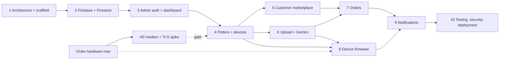

# Development Roadmap

See also: [PROJECT_ANALYSIS](PROJECT_ANALYSIS.md) · [SYSTEM_ARCHITECTURE](SYSTEM_ARCHITECTURE.md) · [DATABASE_DESIGN](DATABASE_DESIGN.md) · [API_DESIGN](API_DESIGN.md)

## Rules for every phase
1. Explain intent before changing files; inspect existing files first; don't overwrite working code unnecessarily.
2. Complete working code only; no placeholders presented as finished.
3. No hardcoded secrets; `.env.example` updated; docs updated.
4. Tests (unit + emulator integration) pass **before** the phase is declared done; fix errors before moving on.
5. At the end: how to install, configure, run and test + known errors/fixes. **Stop and ask for approval** before the next phase.

## Dependencies between phases

Hardware (ESP32-S3 with PSRAM, A7670E board, SIM, antenna, 18650 + charger, TFT, button, buzzer) has a lead time: **order during Phase 1–2** and validate the cellular + TLS link on the bench as early as possible; it is the biggest schedule risk.

Effort figures are single-engineer estimates, not commitments.

---

## Hardware spike H0 — modem and TLS feasibility *(≈ 3–5 days, parallel with Phases 2–3, **gate before Phase 4**)*
The credential scheme (bearer secret over HTTPS) is only safe if the modem path verifies server certificates, and the whole product fails if the cellular link doesn't work in Bangladesh. Prove both early with a throw-away bench sketch (not production firmware) against a public HTTPS test endpoint and, later, the dev backend:
1. A7670E registers on target operators (Grameenphone, Robi, Banglalink, Teletalk) with the chosen SIM plan; record bands, signal, attach time.
2. HTTPS request succeeds **and a request to a host with a wrong/self-signed certificate is refused** (fail-closed proof). If the modem's TLS can't do this, switch to ESP32-side TLS over PPP and re-test.
3. Network time via `AT+CCLK` is valid; root CA embedded and validated.
4. 200 KB JPEG upload success rate and duration over 4G (≥ 20 attempts, incl. weak signal); behaviour on mid-transfer disconnect.
5. Power: no brown-out/reset during TX bursts on the intended battery + charger + capacitor.
6. UART level and pin budget confirmed on the chosen ESP32-S3 board.
**Exit:** a short written result in `docs/FIRMWARE.md`. If 1, 2 or 5 fail, stop and re-plan hardware/operator before Phase 4.

## Phase 1 — Project architecture and structure *(≈ 2–3 days)*
**Status:** documentation delivered here; **awaiting approval**. A minimal code scaffold from the earlier pass already exists (`backend/` skeleton with health route, config validation, error handler, 5 passing tests; `web/` and `admin/` Vite+Tailwind+Router+Axios shells). It will be reviewed against the approved design and adjusted if needed.

* **Deliverables:** the five docs; repo layout; scaffold; `.env.example` files; README; `.gitignore`.
* **Remaining after approval (scaffold alignment, no new features):**
  * Extend logger redaction to `x-tracking-token` and buyer phone/address fields (the current scaffold only redacts `authorization`, `cookie` and `x-device-secret`).
  * Remove the obsolete `DEVICE_SECRET_PEPPER` comment from `backend/.env.example`; add `NOTIFICATION_ESCALATION_MINUTES`.
  * Initialise git (the folder is not yet a repository), verify with `git check-ignore -v backend/.env web/.env.local admin/.env.local` **before the first `git add`**, and make the first commit.
  * Install a secret scanner (gitleaks pre-commit hook + CI step) **before any real credential exists**.
  * Add lint/format config if wanted. Empty architectural layers are created only in the phase that fills them.
* **Phase mapping vs the PDF §12:** the ten PDF phases are kept. Two intentional shifts: the device **authentication** middleware lands in Phase 4 (it is needed to test device-to-potter isolation as soon as devices exist) and the device **upload** endpoint lands in Phase 6 with Gemini; Phase 8 covers firmware and finalises the device contract; the notification endpoints are Phase 9.
* **Test:** `backend npm test`; both frontends build; three dev servers run; "API: online" badge appears; CORS rejects unknown origins.
* **Exit:** you approve the architecture.

## Phase 2 — Firebase project setup and Firestore design *(≈ 1 week)*
**Status: implemented, awaiting review.** Delivered: Admin SDK configuration with strict env validation (emulator mode vs real mode, project/credential cross-check, no emulators in production), read-only connectivity probe + `/health/ready`, repositories with zod validation and transactional relationship rules for all 11 collections, generated `firestore.indexes.json` (28 indexes), deny-all Firestore rules and public-read-only-`public/products/**` Storage rules, web Firebase **Auth** client (Firestore/Storage deliberately not used from the browser), logger redaction, git init + ignore rules. Tests: 32 unit + 31 emulator + 4 web, all passing. Known limitations: [DATABASE_IMPLEMENTATION.md §9](DATABASE_IMPLEMENTATION.md#9-known-limitations-and-deferred-items-tracked-for-the-final-audit). **Not yet done:** running against a *real* Firebase project (needs your project: [FIREBASE_SETUP.md](FIREBASE_SETUP.md)).

Original plan:
* **Build:** Firebase project (asia-south1, Blaze + budget alerts, separate dev/prod); `firebase.json` + emulators (Auth, Firestore, Storage); `firestore.rules`, `storage.rules`, `firestore.indexes.json`; `config/firebase.js` (service account from base64 env); repositories + ID/counter utilities; `scripts/seed.js`; Firestore ping in `/health`.
* **Env:** `FIREBASE_PROJECT_ID`, `FIREBASE_STORAGE_BUCKET`, `FIREBASE_SERVICE_ACCOUNT_B64`, emulator hosts for tests.
* **Tests:** rules tests (all client reads/writes denied on every collection, Storage private/public paths); counter transaction under concurrency yields unique `POT-`/`DEV-` IDs; seed script idempotent; repositories CRUD against emulator.
* **Risks:** Blaze requirement; wrong region (permanent); service-account leakage → never commit; index mistakes → emulator + `firebase deploy --only firestore:indexes` dry run.
* **Exit:** emulator test suite green; backend connects to real dev project; `/health` reports Firestore OK.

## Phase 3 — Admin authentication and dashboard *(≈ 1–1.5 weeks)*
**Status: implemented, awaiting review.** Delivered: backend `authenticateUser` (Firebase ID token, `checkRevoked`, 401 vs 503), `requireRole`, strict query validation, failed-auth and per-admin rate limits; trusted `manage-admin` script (grant/revoke/list, `--create` with one-time reset link, no passwords on the command line, last-superadmin guard, audit entries); `GET /api/admin/{me,dashboard,activity,orders,products,search,admins}` backed by Firestore `count()` aggregations; admin app (login, persistent session, protected routes, role-aware shell, sidebar/top bar with ID search and notification bell, Overview with 8 live stats, order chart, device connectivity, recent orders/products, activity feed, Settings, placeholder pages that state their phase); emulator-only demo seeding script. Tests: 41 backend unit + 43 emulator + 7 admin + browser run against the emulators (login, invalid login, non-admin, protected routes, persistence, mid-session revocation, logout, mobile layout). **Not done:** admin **MFA** (needs Identity Platform; see ADMIN_AUTH.md §3), Potters/Devices/Products/Orders/Customers/Reports pages (Phases 4–10), anything requiring a real Firebase project (see ADMIN_AUTH.md §4).

Original plan:
* **Build:** `authUser` (verifyIdToken, revoked check), `requireRole`; `scripts/create-admin.js` (sets claim + `admins` doc); **MFA/2-step verification for admin accounts** (SYSTEM_ARCHITECTURE §5.5); `GET /api/admin/dashboard` (count aggregations incl. orders needing attention); admin app: Firebase sign-in, `AuthContext`, `RequireAuth/RequireRole`, token-attaching Axios interceptor, `AdminLayout` (sidebar/topbar/responsive), `StatCard`, `DataTable`, overview page.
* **Tests:** no token → 401; customer token → 403; admin → 200; revoked/expired token rejected; dashboard counts match seed data; UI guards redirect unauthenticated users.
* **Risks:** claim propagation delay (force token refresh after claim change); CORS/credentials mismatch; leaking admin routes in customer bundle (separate apps prevent this).
* **Exit:** an admin can sign in and see live counts; non-admins cannot reach any `/api/admin/*`.

## Phase 4 — Potter registration and device assignment *(≈ 1.5–2 weeks)*
**Status: implemented, awaiting review.** Delivered: potter registration (transactional `POT-####`, Bangladesh phone normalisation, 64-district validation, phone uniqueness via `potter_phones` reservation, edit, activate/deactivate with audit, list with status/district filters, search by name/phone/ID, profile with devices/products/orders); device registration (server-generated 256-bit secret shown once, SHA-256 only, `model`, fingerprint reference), assign/reassign/enable/disable/lost/revoke/reissue (all transactional and audited), derived online/offline, communication history (`device_events`) and administrative history; `authenticateDevice` middleware (constant-time, generic 401, 403 only after a valid secret, per-IP/per-device failure throttle, per-device limiter) and `POST /api/device/heartbeat`; admin UI (potter list/new/edit/profile with tabs, device list/new/details, assign dialogs, confirm dialogs, one-time secret dialog, URL-persisted filters, cursor pagination); `scripts/backfill-potters.js`. Tests: 50 backend unit + 66 emulator (23 in `management.test.js` covering the 14 required scenarios) + 13 admin + 4 web; browser run against the emulators. **Not done:** a device simulator CLI (the heartbeat was exercised with real HTTP calls and the emulator test suite), upload/notification/ack device endpoints (Phases 6–9), TTL policy for `device_events`, shared (multi-instance) failure throttle, anything requiring a real Firebase project.

* **Build (original plan):** potters CRUD + activate/deactivate; device registration (server-generated 32-byte secret, shown once, stored as `SHA-256`); assign/reassign (transaction + audit); status (`active/disabled/lost`); rotate secret; **`authDevice` middleware** with failed-auth limiter and per-device limiter; derived online/offline + last-seen; admin UI for potters and devices; **device simulator** (auth + heartbeat). Prerequisite: spike H0 passed.
* **Env:** none new (no pepper).
* **Tests:** secret never stored/returned after creation; constant-time compare incl. unknown-ID path; wrong secret and unknown device both 401; disabled/lost → 403 immediately (only after a valid secret); failed-auth limiter never blocks a valid secret; reassignment moves ownership atomically; **disabling/reassigning a device re-targets its pending notifications (or flags the order)**; inactive potter blocks device; isolation: device A cannot affect B.
* **Risks:** secret handling in UI (show once, copy button, no logging, never accept a client-chosen secret); secret leaks in operator chat/email during provisioning (provision on a trusted machine, rotate if exposed).
* **Exit:** simulator authenticates as `DEV-001`, heartbeat updates `lastSeen`, admin sees online status; revocation works instantly.

## Phase 5 — Customer marketplace *(≈ 1.5 weeks)*
**Status: implemented, awaiting review.** Delivered: public catalogue API (`/api/products`, `/api/products/:id`, `/api/categories`, `/api/potters/featured`, `/api/districts`) with allow-listed payloads, search/category/price/sort and cursor paging; customer API (`/api/customers/me`, profile, up to 5 saved addresses, own orders); **order placement** (`POST /api/orders`, `GET /api/orders/:id`) with required idempotency keys, duplicate guard, stock reservation, tracking token for guests, per-IP/per-phone limits and owner/token/admin access; `OrdersRepository.cancel` (restores stock); storefront in `web/` (home, shop, product, cart, checkout, order confirmation, guest tracking, register/login/logout, account, addresses, order history/detail). Tests: 50 backend unit + 84 emulator (18 new) + 14 web logic + 13 admin; browser run against the emulators. **Not done / deferred:** admin product CRUD/approval UI and real photos/`sharp` image variants (Phase 6), notifications for potters (Phase 9), admin order status/cancel endpoints (Phase 7), testimonials (no data), email verification/password reset. See [CUSTOMER_MARKETPLACE.md](CUSTOMER_MARKETPLACE.md). *Design change:* stock is reserved at order creation instead of at confirmation.

* **Build (original plan):** public APIs (`/api/products`, `/api/products/:id`, categories, featured potters) with allow-listed payloads, `searchTokens`, cursor pagination, indexes; admin product CRUD/approve/reject/remove (manual creation or seed so there is data); web app: Home, Shop (search, category, price filters, sort, load-more), Product details, layout/theme (terracotta/beige/cream/brown), loading/empty/error states; image variants via `sharp` on approval.
* **Tests:** unapproved/removed/**suspended** products never public; deactivating a potter suspends their products and reactivation restores them; no `potterId/deviceId/ai*` in public payloads; filters/sorts/pagination correct; multi-word search behaves as documented; approve without price → 400; responsive visual check.
* **Risks:** Firestore query limits (range on one field) → documented index combinations; search quality (token search only).
* **Exit:** shop works end-to-end on emulator/dev data.

## Phase 6 — Product image upload and Gemini integration *(≈ 1–1.5 weeks)*
* **Build:** `POST /api/device/upload` (raw JPEG, size/magic/decode checks, per-device quota, idempotent via `X-Capture-Id`); storage service; draft product creation; AI worker with lease/retry/backoff; Gemini service (JSON schema output, fixed prompt, "unknown" rules, `isPottery` + quality flags); zod validation + sanitisation; admin review UI (AI badge, flags, edit, set price, approve); simulator upload command.
* **Env:** `GEMINI_API_KEY`, `GEMINI_MODEL`.
* **Tests:** non-JPEG → 415; truncated JPEG (no end marker) and oversize → rejected; duplicate capture → single product, single AI job; **crash/failure between Storage write and DB transaction leaves no imageless product and the retry succeeds**; Gemini mocked for unit tests + a few real calls with sample images; malformed/hostile AI output rejected/sanitised; failure → retries with backoff → `failed` + `ai_failed` flag, still reviewable by admin; price never set by AI; worker recovers after restart (expired lease); orphan-blob cleanup.
* **Risks:** cost (daily cap), prompt injection (sanitise + admin approval), model deprecation (env var), data-use terms of the chosen Gemini tier.
* **Exit:** simulator photo → draft product with AI fields visible to admin; approve publishes it to the shop.

## Phase 7 — Order management system *(≈ 1.5 weeks)*
* **Build:** `POST /api/orders` (`idempotency_keys` doc + recent-duplicate guard, snapshots, transactional order + history + notification, `needsAdminAttention` with `attentionReason` `no_active_device`/`device_offline`, `blocked_phones` check); guest tracking token (re-issued on idempotent replay, URL-fragment link); `GET /api/orders/:id`; state machine; `PATCH status/price`; `GET history`; stock decrement at confirm; admin order UI (filters, detail, status/price forms, history timeline, courier fields) + blocked-phones and notifications queue screens; customer checkout, confirmation and tracking pages; optional account + `GET/PUT /api/me` + `/api/me/orders`; anti-abuse (rate limits, App Check/OTP decision).
* **Tests:** illegal transition → 409; duplicate submit (same key, **including two concurrent requests**) → one order; same phone+product under a new key within 10 min → 409; lost-response replay returns a working tracking token; blocked phone → 403; confirm decrements stock once, concurrent confirms can't oversell; cancel restores; system `seller_notified` never regresses a later admin status; customer A cannot read B's order; wrong token → 404; PII absent from customer view; history row for every change (including creation).
* **Risks:** spam/fake orders; stock races (transactions); phone normalisation.
* **Exit:** full order lifecycle works through admin + customer UIs; notification rows are created (not yet consumed).

## Phase 8 — IoT device APIs and ESP32-S3 firmware *(≈ 2–3 weeks; hardware-bound)*
* **Build:** firmware (PlatformIO): button/wake handling, camera capture + JPEG settings, LittleFS/SD queue, modem driver (A7670E, AT/PPP), HTTPS with embedded root CA and modem time sync, upload with backoff/jitter, credentials in NVS, heartbeat, deep sleep, feedback (LED/buzzer/TFT status); finalise device API contract and `docs/FIRMWARE.md` (wiring, pin map, power design, provisioning).
* **Bench steps** (spike H0 already proved steps 1–3 and 5 on a bench sketch; here they are repeated in production firmware): (1) modem registers on a Bangladeshi network, (2) HTTPS GET to backend, (3) TLS with certificate verification + time, (4) capture JPEG, (5) upload over 4G, (6) offline → buffered → flushed, (7) brown-out/power tests under TX bursts, (8) battery life measurement.
* **Tests:** upload retry with same capture ID is idempotent; airplane-mode simulation; invalid credentials show error; large-frame memory stability; field test in a weak-signal location; **power cut during an image write leaves no corrupt queue entry (write to temp file, flush, then atomic rename; checksum on read)**; queue full → oldest dropped **and** reported via `droppedUploads`; reboot with queued photos resumes uploading; button double-press doesn't create two captures within a debounce window; the device gives distinct feedback for "uploaded", "will retry" and "discarded".
* **Risks:** band/operator compatibility **[VERIFY]**, UART level (1.8 V), power brown-outs, PSRAM/pin conflicts, certificate expiry (OTA is post-v1), IMEI/regulatory registration.
* **Exit:** pressing the button on real hardware produces a draft product visible to the admin.

## Phase 9 — Notification system *(≈ 1 week)*
* **Build:** `GET /api/device/notifications` (join order, mark delivered, `seller_notified`), `POST /api/device/acknowledge`, re-delivery until acknowledged, expiry, **escalation sweep in the worker (`NOTIFICATION_ESCALATION_MINUTES`) that sets `needsAdminAttention`**, admin "orders needing attention" card and notifications queue; firmware: timer-wake polling, notification screen (big digits, thumbnail, buzzer/LED), context-based button (ack vs capture), PII not persisted; Bengali text approach decided (digits-only vs server-rendered bitmap).
* **Tests:** device A never receives device B's notifications; duplicate poll doesn't duplicate; unacknowledged re-served; ack idempotent; foreign ack → 404; expired not served; **order to an offline device is flagged `device_offline` at creation; an unacknowledged notification is flagged `unacknowledged` after the threshold by the sweep (clock-controlled test)**; end-to-end: order on web → buzzer + buyer info on device within one poll interval.
* **Risks:** battery vs polling interval; Bengali rendering; potter misses alert (escalation to admin).
* **Exit:** real order appears on the device; acknowledgement is visible to admin.

## Phase 10 — Testing, security and deployment *(≈ 1–2 weeks + pilot)*
* **Build/verify:** full emulator + e2e test suite in CI; security review checklist (OWASP API top 10, rules tests, dependency audit, secret scan, CORS, headers, rate limits, logging redaction); load test of list/poll endpoints; **`stats` aggregate counters for reports at scale (DATABASE_DESIGN §8)**; shared rate-limit store if more than one backend instance is planned; backups (scheduled Firestore export) and restore drill; monitoring/alerts (uptime, AI failure rate, offline devices); deploy: Vercel (web, admin with correct `VITE_*`), Railway/VPS backend (env secrets, `TRUST_PROXY_HOPS`, health check), Firebase rules/indexes deploy; `docs/DEPLOYMENT.md` runbook and incident procedures (lost device, leaked secret, rotate service account); production flash encryption for pilot devices.
* **Pilot:** 3–5 potters, 2–4 weeks, daily review of failures; collect usability findings; tune poll interval and AI prompt.
* **Exit:** checklist green; pilot success criteria met (e.g. ≥95% of captures become drafts; every order acknowledged or escalated within agreed time).

---

## Overall timeline (estimate)
Phases 1–2 ≈ 1.5 weeks · 3–4 ≈ 3 weeks · 5 ≈ 1.5 weeks · 6 ≈ 1–1.5 weeks · 7 ≈ 1.5 weeks · 8 ≈ 2–3 weeks · 9 ≈ 1 week · 10 ≈ 1–2 weeks → **≈ 12–15 weeks to a pilot** (phases 5 and 6 can overlap if two people work in parallel).

## Open items to resolve (by phase)
| Item | Needed by |
|------|-----------|
| Confirm admin-only order status/price updates; one photo = one draft product; Blaze billing | Phase 2 |
| Customer anti-abuse choice (OTP vs App Check/reCAPTCHA) | Phase 7 |
| Operator/band confirmation, SIM plan, IMEI registration | Phase 8 (order early) |
| Bengali text on device | Phase 9 |
| Data-retention policy for orders/PII | Phase 10 |
