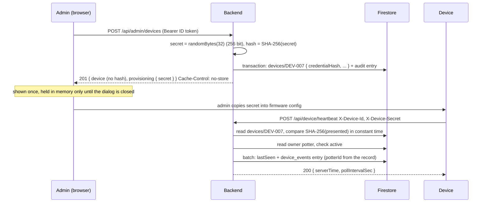

# Potter and Device Management (Phase 4)

Admin workflows for registering potters and IoT devices, provisioning device credentials and keeping ownership consistent. Contracts: [API_DESIGN.md §11.1](API_DESIGN.md#111-phase-4-potters-and-devices). Data model: [DATABASE_DESIGN.md](DATABASE_DESIGN.md) §3.1, §3.2, §3.9.

## 1. Quick start

```powershell
cd backend ; npm run emulators          # terminal 1 (Auth 9099, Firestore 8080, Storage 9199)
cd backend ; npm start                  # terminal 2 (http://127.0.0.1:4000)
cd admin   ; npm run dev                # terminal 3 (http://localhost:5174)
```

Sign in as an admin (see [ADMIN_AUTH.md](ADMIN_AUTH.md)). Data created before Phase 4 needs a one-off migration (adds search fields and phone reservations; safe to repeat):

```powershell
cd backend ; node --env-file=.env scripts/backfill-potters.js --dry-run   # report only
cd backend ; node --env-file=.env scripts/backfill-potters.js             # apply
```

## 2. Register a potter

1. **Potters → Register potter.**
2. Fill in: full name, Bangladesh mobile number (`01712345678`, `+8801712345678` and `+880 1712-345678` are all accepted and stored as `01712345678`), village, district (one of the 64 districts) and full address.
3. Save. The backend generates the next `POT-####` ID inside a transaction together with the phone reservation and an audit entry, and you land on the potter's profile.

A phone number can belong to only one potter. Registering the same number again, in any format and even from two browsers at once, fails with *"Another potter is already registered with this phone number."*

On the **profile** you can edit details, activate/deactivate (with confirmation), see counts, and use the **Devices / Products / Orders** tabs. Deactivating a potter hides their approved products from customers and makes their devices get `403` until the potter is activated again; nothing is deleted.

## 3. Register and assign a device

1. **Devices → Register device.** Optionally set the model and polling interval. Press *Generate device and credentials*.
2. The **credentials dialog** shows the Device ID and the **secret once**. Copy it into the firmware configuration (a *Copy both as config lines* button gives `DEVICE_ID=…` / `DEVICE_SECRET=…`). The dialog cannot be closed (Escape and click-outside are disabled) until you tick *I have copied the secret*.
3. The device is `unassigned`: it authenticates but is refused (`403`) because it has no owner.
4. On the device page press **Assign to potter**, search for an *active* potter by name, phone or Potter ID, and confirm. The device becomes `active`.

One potter can own many devices (repeat step 4). A device has exactly one owner at any time: **Reassign** moves it atomically; orders still waiting to be delivered to it are re-targeted to the previous owner's other active device or flagged for follow-up (existing Phase 2 logic).

## 4. Credential provisioning (how secrets are protected)



| Property | How it is achieved |
|----------|--------------------|
| Unique credentials per device | A new random secret per registration/reissue; IDs from a transactional counter; creation uses `tx.create`, so an existing device can never be overwritten (`409 ID_COLLISION`) |
| Strong secret | 32 bytes from the OS CSPRNG, base64url (43 chars). Never client-chosen |
| Only a hash is stored | `credentialHash = SHA-256(secret)`. For a 256-bit random secret a fast hash is safe (nothing to brute-force) and cheap per request. The secret is never written to Firestore, logs or audit entries |
| Shown once | Only in the `201` response of *register* and *issue new credentials*; admin views expose `hasCredential`, an 8-character fingerprint of the digest and the version |
| Owner is never taken from the device | `req.device.potterId` is read from the stored device record; a `potterId` in the body or query is `400`, in a header it is ignored |
| No oracle for attackers | Unknown ID, wrong secret, revoked and malformed credentials all return the same `401` after the same work (a dummy compare is used when no hash exists); only a *correct* secret reveals that the device is disabled (`403`) |
| Failed-attempt throttle | Per IP and per Device ID, consulted only after a failed check, so legitimate devices behind a shared carrier NAT are not blocked; valid requests also have a per-device limit (60/min) |
| Revocation is immediate | The hash is **deleted**; nothing can match afterwards. No cache exists to invalidate |
| Redaction | The logger redacts `X-Device-Secret`, `Authorization`, `credentialHash`, `*.secret`, phone and address; a test asserts the secret and the digest appear in no read API, audit entry or log line |

### Operations

| Situation | Action | Result |
|-----------|--------|--------|
| Secret leaked, device still trusted | **Issue new credentials** | New secret shown once; the old one stops working immediately; status unchanged |
| Device returned / retired | **Revoke credentials** | Hash deleted, version bumped; an active device becomes `disabled` and its pending notifications are re-targeted |
| Device stolen or lost | **Mark as lost or stolen** | Status `lost` **and** credentials revoked in one transaction; it can no longer authenticate |
| Lost device found | **Recover device**, then **Issue new credentials**, then **Enable** | `lost → disabled → (new credential) → active`; each step is audited. Reissuing while `lost` is refused on purpose |
| Temporary pause | **Disable** / **Enable** | Credentials kept; `403` while disabled |

Enabling or assigning a device without a valid credential is refused (`409 NO_CREDENTIAL`), so a device can never be `active` yet unable to authenticate.

## 5. Statuses

Stored (`status`): `unassigned`, `active`, `disabled`, `lost`. **Offline is derived** and never stored, because a device that lost power cannot report itself offline: an `active` device whose `lastSeen` is older than `DEVICE_ONLINE_WINDOW_SEC` (default 900 s) or null is shown as *Offline*. The device list filters (`active`, `offline`, `unassigned`, `disabled`, `lost`) and the dashboard counters use the same definition. *Network status* on the device page shows `Online`, `Offline` or `Never connected`.

## 6. Communication history

`GET /api/admin/devices/:id/events` (device page → *Communication*): every authenticated heartbeat with its telemetry, and every refused-but-authentic request (`Refused: device is disabled`, …). Requests that fail authentication are **not** stored, so an attacker cannot grow the database; they are visible in structured logs and the rate-limit counters. The *Administrative history* tab shows who registered, assigned, enabled, disabled, revoked or reissued, with the optional reason.

## 7. Tests

```powershell
cd backend ; npm test                    # 50 unit tests (credentials, throttle, districts, connectivity, schemas, indexes…)
cd backend ; npm run test:emulator       # 66 integration tests; stop the dev emulators first (same ports)
cd admin   ; npm test ; npm run build
```

`backend/tests/emulator/management.test.js` covers the 14 required scenarios against the real Express app and the Firebase emulators:

| # | Scenario | Test |
|---|----------|------|
| 1 | Register a potter | `1.`, `1b.` |
| 2 | Duplicate potter (formats, concurrency) | `2.` |
| 3 | Edit a potter, phone moves, cannot steal a number | `3.` |
| 4 | Activate / deactivate | `4.` |
| 5 | Register a device; secret once, hash only | `5.`, `5b.` |
| 6 | Duplicate Device ID prevention | `6.` |
| 7–8 | Assign; several devices per potter | `7-8.` |
| 9 | Reassign; one owner under racing requests | `9.` |
| 10 | Invalid assignments | `10.` |
| 11 | Revoke credentials; lost; reissue | `11.`, `11b.` |
| 12 | Disabled/lost/unassigned/revoked device cannot authenticate | `12.` + heartbeat/throttle tests |
| 13 | Unauthenticated, role-less and device callers cannot use management APIs | `13.` |
| 14 | One potter's data/devices never reach another | `14.` |

Not covered by automation: the browser UI (verified manually with Playwright against the emulators; logic and validation helpers have unit tests in `admin/tests`), and anything that needs a **real Firebase project** (real Auth token issuance, TTL policy, deployed index build).

## 8. Known limitations (tracked for the final audit)

* **Failure throttle is per process (in memory).** Correct for one backend instance; with several instances use a shared store (Redis) or edge rate limiting.
* **`device_events` volume:** one small write per heartbeat. At 5-minute polling that is ≈288 writes/device/day; the TTL policy on `expireAt` (30 days) is a console/CLI step tracked with the other TTL policies (Phase 10). Raise `pollIntervalSec` if cost matters.
* **Search:** potter search is prefix/word based with a 50-result cap (Firestore has no full-text search); device search is by ID prefix. Both flag truncation or return fewer results rather than scanning.
* **Existing data:** potters created before Phase 4 need `backfill-potters.js` once, otherwise their phone is not reserved and they are not found by name search.
* **TLS from the modem (Spike H0)** and **admin MFA (U3)** remain open from the architecture audit.
* The device side is limited to `heartbeat`; upload, notification polling and acknowledgement arrive with Phases 6–8.
