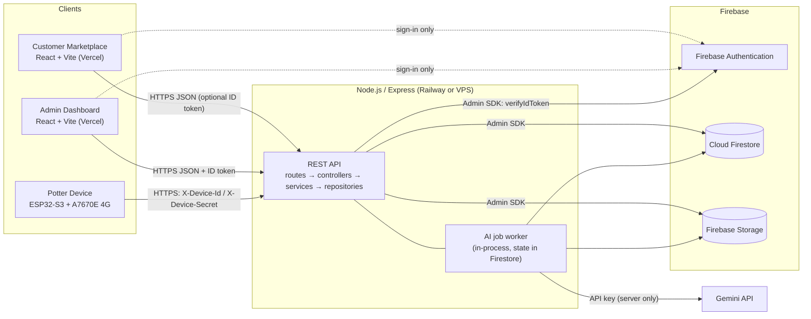
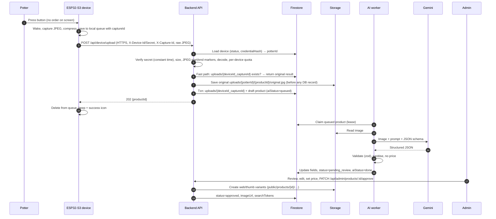
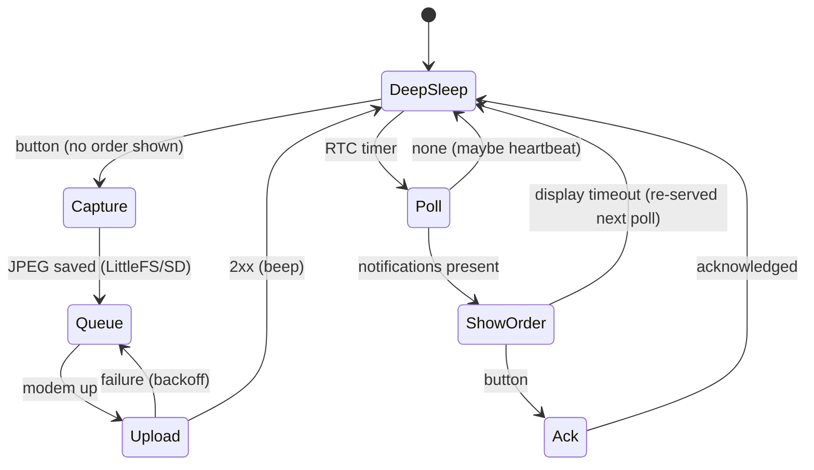
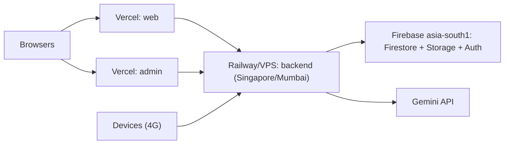

# System Architecture

See also: [PROJECT_ANALYSIS](PROJECT_ANALYSIS.md) · [DATABASE_DESIGN](DATABASE_DESIGN.md) · [API_DESIGN](API_DESIGN.md) · [DEVELOPMENT_ROADMAP](DEVELOPMENT_ROADMAP.md)

## 1. Architecture overview



### Principles
1. **The API is the only gateway to data.** Browsers never read/write Firestore or Storage; Firestore and Storage rules deny all client access (defence in depth). The Admin SDK bypasses rules, so **authorization is enforced in the API layer**.
2. **Identity is derived, never supplied.** Devices are identified by credentials → database lookup; the Potter ID is read from the device record, never from a request body.
3. **Layered backend** (routes → controllers → services → repositories) so rules like the order state machine are testable without HTTP.
4. **AI is asynchronous.** Uploads return `202` after storing the image; a worker processes jobs with state in Firestore (recoverable across restarts; no Redis in v1).
5. **Idempotency everywhere it matters:** device uploads (`X-Capture-Id`), customer orders (`Idempotency-Key`), notifications (deterministic doc ID).
6. **Server time only** (`serverTimestamp()`); money = integer BDT.
7. **Minimal dependencies.**

## 2. Component responsibilities

| Component | Responsible for | Must NOT |
|-----------|-----------------|----------|
| **Customer marketplace** | Browsing, search/filter/sort UI, checkout, order tracking, optional sign-in (Firebase Auth SDK for sign-in only) | Hold secrets; access Firestore/Storage directly; trust its own validation |
| **Admin dashboard** | Admin sign-in, dashboard, potter/device/product/order management, reports | Be reachable without an admin claim; ship to customers (separate bundle/domain) |
| **Backend API** | Verify ID tokens/device credentials, RBAC, validation, rate limiting, business rules, transactions, order state machine, notification creation, image validation/storage, Gemini calls, logging, audit | Return stack traces; accept a Potter ID from devices; expose Admin SDK credentials |
| **AI worker** | Claim queued products, call Gemini with a fixed prompt + JSON schema, validate/sanitise output, write results, retry/fail | Set prices; auto-publish; run unvalidated output |
| **Firebase Auth** | Users (admins, customers), ID tokens, custom claims (`role`) | Authenticate devices |
| **Firestore** | System of record; transactions; counters; aggregation counts | Be queried by clients |
| **Firebase Storage** | Private originals; public web/thumb variants of approved products | Allow client writes |
| **Gemini API** | Image → structured JSON | Be called from a browser or device |
| **ESP32-S3 device** | Button handling, capture, compress, local queue, cellular HTTPS, display/buzzer, deep sleep, poll/ack/heartbeat | Decide Potter ID; store buyer PII persistently; hold shared secrets with other devices |
| **Device simulator** (dev tool) | Exercise device APIs before hardware exists | Ship to production |

## 3. Frontend architecture

Two independent Vite apps (separate bundles, domains and CSP). Small duplication of the API client is accepted to avoid monorepo tooling.

```
web/                                  # customer marketplace
├─ index.html · vite.config.js · .env.example
└─ src/
   ├─ main.jsx
   ├─ app/                            # composition root
   │  ├─ App.jsx · router.jsx         # route table, lazy-loaded pages, error boundary
   │  └─ providers.jsx                # context providers
   ├─ api/                            # transport only
   │  └─ client.js                    # axios instance, interceptors (token attach, error normalisation)
   ├─ services/                       # one module per resource wrapping api/client (products, orders, potters, customers) + tracking-token storage
   ├─ features/                       # vertical slices (components + hooks + local state)
   │  ├─ products/                    # ProductCard, ProductGrid, Filters, SortSelect, useProducts
   │  ├─ search/                      # SearchBar, useProductSearch
   │  ├─ checkout/                    # CheckoutForm, useCreateOrder (Idempotency-Key)
   │  ├─ orders/                      # OrderStatusTimeline, useOrderTracking
   │  └─ auth/                        # SignInForm, ProfileForm (UI only — the AuthProvider lives in context/)
   ├─ context/                        # AuthContext (provider + useAuth), CartContext (single-item order request), ToastContext
   ├─ hooks/                          # shared: useDebounce, useInfiniteList, useQueryParams
   ├─ components/                     # presentational: Button, Input, Modal, Spinner, Layout, Header, Footer, ErrorState
   ├─ pages/                          # Home, Shop, ProductDetails, Checkout, OrderConfirmation, TrackOrder, MyOrders, NotFound
   ├─ lib/firebase.js                 # Firebase Auth init (public web config only)
   ├─ utils/                          # formatPrice (BDT), phone (01XXXXXXXXX validation), dates, constants
   └─ styles/                         # Tailwind theme tokens (terracotta, beige, cream, clay-brown)

admin/                                # admin dashboard
└─ src/
   ├─ app/ (router, guards: RequireAuth, RequireRole)
   ├─ api/ (client.js attaches Firebase ID token; 401 → sign-out)
   ├─ services/ · hooks/ · context/ (AuthContext) · utils/ · lib/firebase.js
   ├─ layouts/                        # AdminLayout (Sidebar, Topbar, responsive drawer)
   ├─ components/                     # DataTable, StatCard, StatusBadge, ConfirmDialog, FormField, FilterBar, Pagination
   ├─ features/
   │  ├─ auth/ · dashboard/ · potters/ · devices/ · products/ (review/approve) · orders/ (status, price, history) · reports/
   └─ pages/                          # Login, Overview, Potters, PotterDetail, Devices, Products, ProductReview, Orders, OrderDetail, Reports
```

Conventions: pages compose features; features own their hooks; only `api/` talks HTTP; no business rules duplicated from the backend (UI validation is convenience only); **the backend is the single authority for enums** — categories come from `GET /api/categories`, and the frontends keep only display labels keyed by backend status codes (an unknown code is rendered as-is rather than breaking), so `web/` and `admin/` cannot drift from the API; all list screens use cursor pagination; all admin routes sit behind `RequireAuth` + `RequireRole('admin')`; strings kept in one place per feature (future i18n is cheap).

## 4. Backend architecture

```
backend/
├─ package.json · .env.example
├─ firebase/                           # firebase.json, firestore.rules, firestore.indexes.json, storage.rules
├─ scripts/                            # create-admin.js, seed.js
├─ src/
│  ├─ server.js                        # bootstrap, graceful shutdown, starts worker
│  ├─ app.js                           # helmet, CORS allow-list, body limits, rate limit, routes, errors
│  ├─ config/
│  │  ├─ env.js                        # zod-validated env, fails fast
│  │  ├─ firebase.js                   # Admin SDK init from env (never from repo files)
│  │  ├─ gemini.js                     # client + model name from env
│  │  └─ logger.js                     # pino with redaction
│  ├─ middleware/
│  │  ├─ authUser.js                   # verifyIdToken (checkRevoked always for admin routes) → req.user {uid, role}
│  │  ├─ requireRole.js                # RBAC
│  │  ├─ authDevice.js                 # device credential check → req.device {deviceId, potterId}
│  │  ├─ validate.js                   # zod body/query/params → 400 with details
│  │  ├─ rateLimit.js                  # per-IP public; per-device; strict failed-auth limiter
│  │  ├─ rawJpeg.js                    # express.raw image/jpeg, size cap, magic-byte check
│  │  └─ errorHandler.js
│  ├─ routes/
│  │  ├─ index.js
│  │  ├─ device.routes.js · products.routes.js · orders.routes.js · public.routes.js
│  │  └─ admin/{potters,devices,products,orders,reports,dashboard}.routes.js
│  ├─ controllers/                     # HTTP ↔ service mapping only
│  ├─ services/
│  │  ├─ potters.service.js · devices.service.js (credential generation/rotation/assign)
│  │  ├─ deviceAuth.service.js         # hash/compare, status checks, lastSeen
│  │  ├─ products.service.js · uploads.service.js (idempotent capture handling)
│  │  ├─ orders.service.js             # create, state machine, history, stock
│  │  ├─ notifications.service.js      # create, deliver, acknowledge, re-serve
│  │  ├─ ai/{gemini.service.js, prompt.js, schema.js, sanitize.js}
│  │  ├─ storage.service.js · reports.service.js · audit.service.js
│  ├─ repositories/                    # Firestore access per collection (only layer that imports firebase-admin)
│  ├─ validators/                      # zod schemas per route
│  ├─ workers/aiJobWorker.js           # claims queued products with a lease; retry/backoff
│  └─ utils/                           # ApiError, ids, hash, phone (BD), pagination cursors, money, time
└─ tests/                              # unit + integration against Firebase emulators
```

Layer rules: routes know nothing about Firestore; services own transactions and rules; **only repositories import `firebase-admin`**; controllers never contain business logic; every error is an `ApiError` rendered by the central handler (`{error:{code,message,details?,requestId}}`).

## 5. IoT communication

### 5.1 Photo → published product



Failure handling: no/failed connectivity → image stays queued, retry with exponential backoff + jitter; re-sending the same `X-Capture-Id` is safe (server returns the original result). `4xx` (except 408/429) → drop/flag; `5xx`/timeouts → retry. AI failure → retries (≤3) → `aiStatus=failed` → admin fills in manually.

### 5.2 Order → potter's screen

```mermaid
sequenceDiagram
  autonumber
  participant C as Customer (web)
  participant B as Backend API
  participant F as Firestore
  participant D as ESP32-S3 device
  participant P as Potter
  participant A as Admin

  C->>B: POST /api/orders (Idempotency-Key, product, buyer details, qty)
  B->>F: Load product (approved) → potterId; find potter's active device
  B->>F: Txn: order (pending) + order_history + notification {orderId}_NEW_ORDER
  B-->>C: 201 {orderId, trackingToken}
  loop every pollIntervalSec (timer wake)
    D->>B: GET /api/device/notifications
    B->>F: Notifications where deviceId = authenticated device, status ≠ acknowledged
    B->>F: Join order → build payload; mark delivered; order → seller_notified (first time)
    B-->>D: [notification payload]
  end
  D->>P: Buzzer + LED + big digits + product thumbnail
  P->>D: Press button (acknowledge = seen)
  D->>B: POST /api/device/acknowledge {notificationId}
  B->>F: acknowledged, acknowledgedAt
  P->>C: Phones buyer, negotiates (outside the system)
  A->>B: PATCH status → contacted → price_negotiation, PATCH price, → confirmed → processing → shipped → delivered
  C->>B: GET /api/orders/:id (token or owner) → sees status
```

* Unacknowledged notifications are **re-served on every poll** (this is the retry). **Escalation is automatic, not a pull queue:** an escalation sweep in the backend worker runs every few minutes; any notification still `pending`/`delivered` after `NOTIFICATION_ESCALATION_MINUTES` (default 120) sets `orders.needsAdminAttention = true` (`unacknowledged`). Orders targeting an offline device are flagged immediately at creation (`device_offline`), and orders with no active device are flagged as `no_active_device`. The dashboard shows "orders needing attention" as a headline card.
* **Delivered ≠ accepted:** only `acknowledged` (seen) is device-driven; Contacted/Negotiation/Confirmed are admin-recorded.
* Duplicate prevention: same `Idempotency-Key` + phone returns the existing order (race-free via the deterministic `idempotency_keys` document); a second open order for the same phone + product within 10 minutes is rejected; notification doc ID `{orderId}_{type}` makes creation idempotent.
* If the potter's device is disabled/reassigned while a notification is pending, it is re-targeted to another active device of the same potter, or the order is flagged for admin attention.
* If the potter has no active device, the order is created and flagged for admin follow-up.

### 5.3 Device power/poll cycle



## 6. Security architecture

### 6.1 Device authentication
* `deviceId` + 32-byte random secret generated by the server, **shown once** at registration/rotation; provisioned over USB into NVS (flash encryption for production).
* Stored as `SHA-256(secret)` (secrets are server-generated 32-byte random values, so no pepper is needed — see DATABASE_DESIGN §10); compared with `crypto.timingSafeEqual`. Random high-entropy secrets make a fast hash appropriate; bcrypt would only add CPU per request.
* Sent as `X-Device-Id` / `X-Device-Secret` over HTTPS only; redacted from logs.
* Verification always performs the hash comparison (dummy hash for unknown IDs → no timing/response difference), and only after a valid secret are `status`/potter checks applied (`403`). Unknown device and wrong secret both return `401`.
* Every request re-reads the device record → `disabled`/`lost` take effect immediately. A short in-memory cache (≤30 s) can be added if read costs matter (trade-off: up to 30 s revocation delay).
* Failed-auth limiter per IP only throttles requests that **fail** verification (valid secrets are never blocked, because CGNAT shares IPs). Normal limits per authenticated `deviceId`; daily upload cap per device protects Gemini cost.
* Rotation and revocation by admin, per device; audited. **TLS is fail-closed:** firmware must verify the server certificate against an embedded root CA and refuse to send credentials if verification is unavailable or fails (a bearer secret over unverified TLS is exposed to any man-in-the-middle). This is proven on real hardware in spike H0 (see roadmap) before the credential scheme is finalised; if the modem's TLS stack cannot verify certificates, TLS is done on the ESP32 over PPP.
* **Blast radius of one stolen device** is bounded: its secret only permits photo uploads (quota-capped, always land as admin-reviewed drafts) and reading *that* potter's notifications; the admin disables it instantly. Production units use ESP32 flash encryption so the secret is not trivially readable from flash.

### 5.4 Customer authentication
* Guest checkout: no account. Each order gets a 128-bit random tracking token; only its hash is stored. Tracking = `orderId + token`, carried in the `X-Tracking-Token` header (the confirmation link keeps it in the URL **fragment**, which is never sent to servers or logs). A replayed idempotent order request re-issues a fresh token.
* Optional Firebase Auth account (email/Google; phone OTP if budget allows). Logged-in owner may read their own orders (`customerId == uid`).
* Anti-abuse on `POST /api/orders`: per-IP and per-phone rate limits, idempotency + recent-duplicate guard, `blocked_phones` block-list (works for guests), reCAPTCHA/App Check or OTP **[decide Phase 7]**.

### 5.5 Admin RBAC
* Firebase ID token verified on every admin request with `checkRevoked: true`; role from custom claim `role ∈ {admin, superadmin}`; `requireRole()` middleware. Deactivating an admin also calls `revokeRefreshTokens(uid)`.
* Claims are set only by the `create-admin` script / superadmin endpoint; the `admins` collection mirrors them for listing.
* Superadmin-only: creating admins, rotating device secrets (configurable), deleting data.
* **Admin account protection:** admins can read every buyer's personal data and set prices, so a stolen admin login is a full breach. Require multi-factor authentication for admin accounts (Firebase MFA requires the Identity Platform upgrade **[VERIFY]**; fallback: Google sign-in on accounts with enforced 2-step verification plus the backend role claim as an allow-list), keep the admin count small, and never let the public sign-up flow create an admin.
* Sensitive actions write `audit_logs` (who, what, before/after).

### 5.6 Potter data isolation
1. Potter = device credential → `req.device.potterId` comes from the database.
2. No endpoint accepts a potter-supplied `potterId`; device queries are always scoped by `req.device`.
3. Ownership is explicit in `devices.potterId`; reassignment is an admin transaction + audit entry.
4. Acknowledging another device's notification returns `404`.
5. Customers see only approved products and their own orders; public product/seller payloads include **no** potter phone/address.
6. Automated isolation tests (Phase 4/7/9/10) run against emulators.

### 5.7 API security
Helmet; CORS allow-list; small JSON limit (100 KB), separate raw-JPEG limit on upload; zod validation on every input; centralised errors (no stack traces); request IDs; structured logs with secret/PII redaction; rate limits (public per IP, device per deviceId); `trust proxy` configured for Railway; image validated by size + magic bytes + decode; Storage paths built server-side only; dependency audit in CI; HTTPS enforced at host; HSTS via Helmet.

### 5.8 Firebase security rules
* **Firestore:** `allow read, write: if false;` for all client access. Tested in the emulator.
* **Storage:** no client writes. `uploads/**` (originals) no client read. `public/products/**` public read for approved variants only (created by backend on approval; removed on rejection/removal).
* Rules + indexes are committed under `backend/firebase/` and deployed via CLI.

### 5.9 Environment variable management

| Variable | Where | Secret? |
|----------|-------|---------|
| `NODE_ENV, PORT, LOG_LEVEL, CORS_ORIGINS, TRUST_PROXY_HOPS` | backend | no |
| `FIREBASE_PROJECT_ID, FIREBASE_STORAGE_BUCKET` | backend | no |
| `FIREBASE_SERVICE_ACCOUNT_B64` | backend (Railway secret) | **yes** |
| `NOTIFICATION_ESCALATION_MINUTES` (default 120) | backend | no |
| `FIREBASE_AUTH_EMULATOR_HOST, FIRESTORE_EMULATOR_HOST, FIREBASE_STORAGE_EMULATOR_HOST` | backend (local/CI tests only) | no |
| `GEMINI_API_KEY` | backend | **yes** |
| `GEMINI_MODEL` | backend | no |
| `VITE_API_URL`, `VITE_FIREBASE_*` (web config) | frontends | public by design |

Rules: `.env*` git-ignored (only `.env.example` committed); env validated at boot (fail fast); service-account JSON never in repo; separate Firebase projects for dev/staging/prod; secrets rotated on exposure; no secrets in `VITE_*`.

Additional controls: (1) the backend's Firebase service account is a **dedicated least-privilege account** (Firestore, Storage bucket and Auth admin roles only — not Owner); it is base64-**encoded** in `FIREBASE_SERVICE_ACCOUNT_B64`, which is encoding, not encryption, so only trusted people get access to the Railway project; (2) developers and CI use the **Firebase emulators**, so production credentials never exist on laptops; (3) the Gemini key is restricted (API restriction, quota, billing budget alert); (4) the public Firebase web API key is restricted by HTTP referrer and App Check is enabled where supported; (5) a secret scanner (e.g. gitleaks) runs as a pre-commit hook and in CI from the first commit that can contain credentials; (6) logs redact `Authorization`, `X-Device-Secret`, `X-Tracking-Token` and buyer phone/address.

## 7. Deployment topology



Single backend instance for the pilot (the in-process AI worker uses Firestore leases so a second instance would also be safe). **Scaling limits to remember:** `express-rate-limit` keeps counters in process memory, so running more than one instance requires a shared store (e.g. Redis) or the limits become per-instance; JPEG bodies are buffered in memory (≤1 MB each), so cap concurrent uploads. Cost sketch at 1,000 devices polling every 5 min: ≈288k device reads + ≈288k `lastSeen` writes per day (roughly US$15/month at current Firestore list prices **[VERIFY]**) — tune `pollIntervalSec` per device from the server. Backups: scheduled Firestore export. Monitoring: uptime check on `/health`, alerts on AI failure rate and offline devices.
